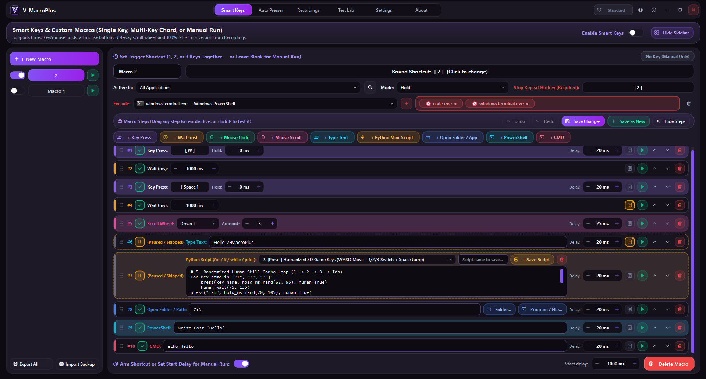
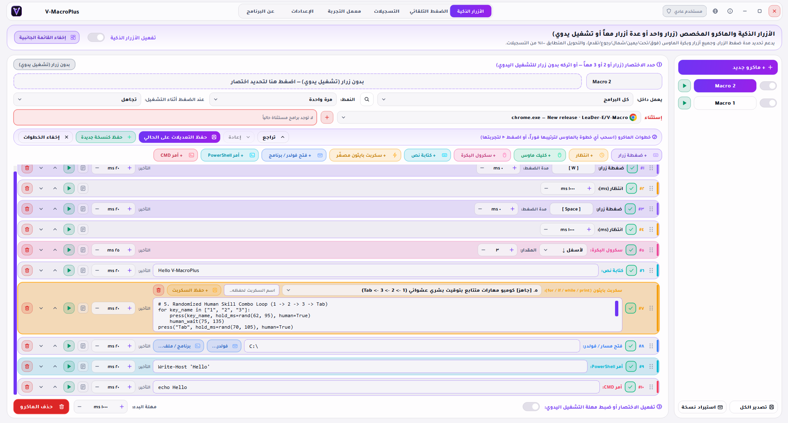
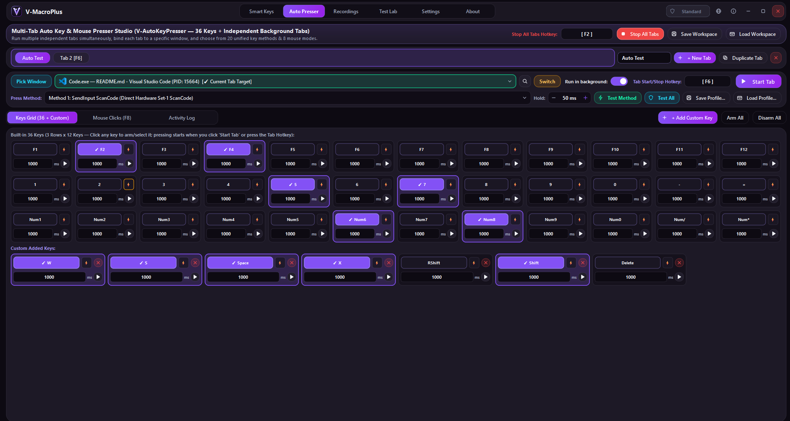
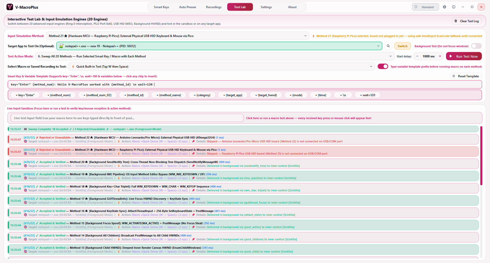
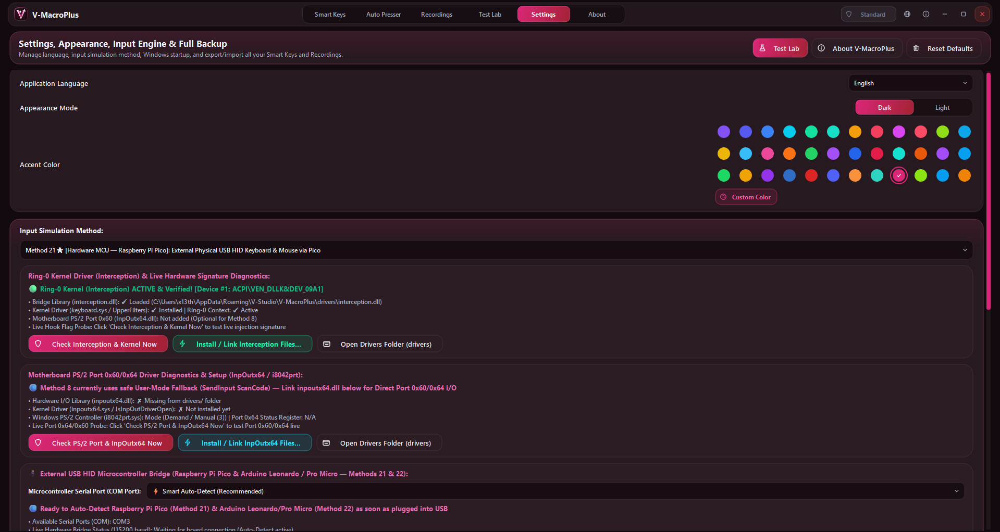
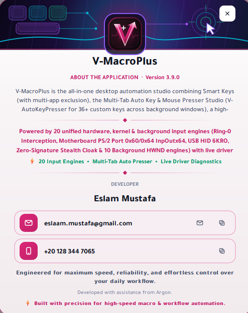
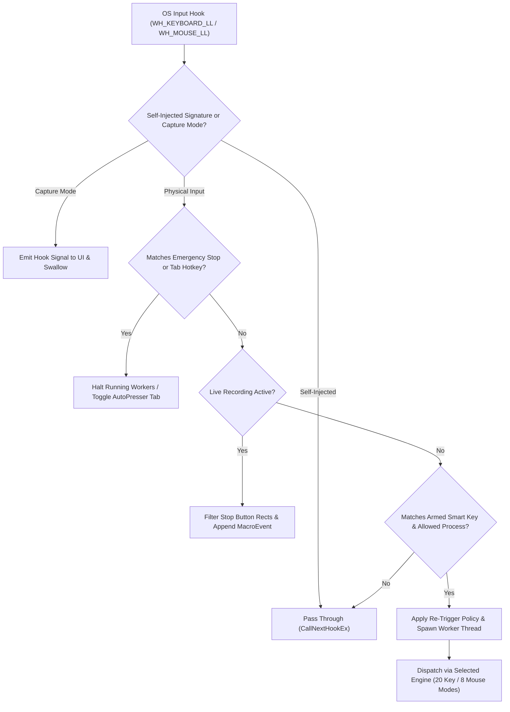
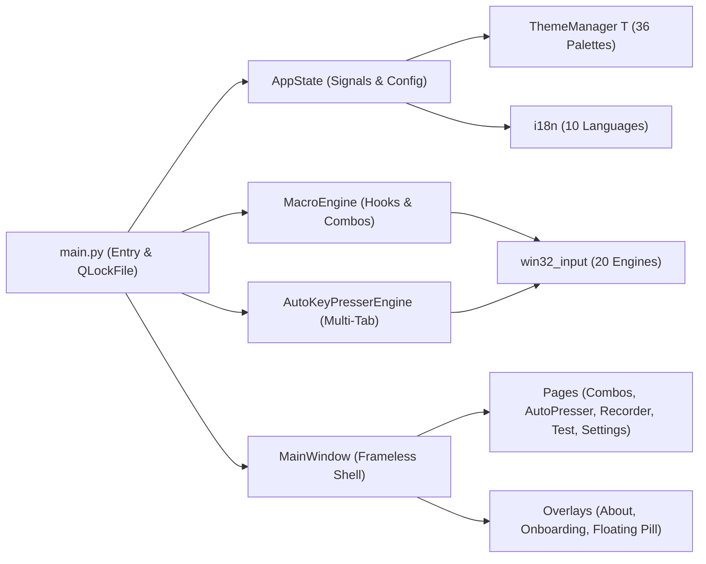

<div align="center">


# V-MacroPlus — Low-Level Hardware Macro, Smart Keys & Multi-Tab Auto Presser Studio

**A low-level Windows and Linux keyboard and mouse automation studio built with Python and PySide6, combining hardware scan-code Smart Keys, a 240 FPS timeline recorder, a multi-tab Auto Key and Mouse Presser studio, 20 switchable foreground and background input injection engines, and a 100% custom-painted glassmorphic interface in 10 languages.**


-06B6D4?style=flat-square)
-F59E0B?style=flat-square)

<!-- Uncomment once docs/screenshots/hero-smart-keys-dark-ar.png is captured:
<br />

-->

</div>

## Table of contents

- [Highlights](#highlights)
- [Screenshots](#screenshots)
- [Features in detail](#features-in-detail)
  - [Smart Keys, custom macros, and Python mini-scripting](#smart-keys-custom-macros-and-python-mini-scripting)
  - [Multi-Tab Auto Key and Mouse Presser Studio](#multi-tab-auto-key-and-mouse-presser-studio)
  - [Native mouse and keyboard recorder](#native-mouse-and-keyboard-recorder)
  - [Interactive Test Lab and 3-mode 20-method sweep](#interactive-test-lab-and-3-mode-20-method-sweep)
  - [Ring-0 Interception kernel driver guide](#ring-0-interception-kernel-driver-guide)
  - [Motherboard PS/2 Port 0x60/0x64 (InpOutx64 / i8042prt) guide](#motherboard-ps2-port-0x600x64-inpoutx64--i8042prt-guide)
  - [Interface, themes, and localization](#interface-themes-and-localization)
  - [System limits and bounds](#system-limits-and-bounds)
- [Quick start](#quick-start)
  - [Requirements](#requirements)
  - [Windows](#windows)
  - [Linux](#linux)
  - [macOS](#macos)
- [Build a standalone application](#build-a-standalone-application)
  - [Windows standalone build](#windows-standalone-build)
  - [Linux standalone build](#linux-standalone-build)
  - [macOS standalone build](#macos-standalone-build)
- [Using the app](#using-the-app)
  - [First run](#first-run)
  - [Main screens](#main-screens)
  - [Settings overview](#settings-overview)
  - [System tray and menus](#system-tray-and-menus)
  - [Command-line flags and environment variables](#command-line-flags-and-environment-variables)
- [Configuration reference](#configuration-reference)
  - [Data directory locations](#data-directory-locations)
  - [Data directory contents](#data-directory-contents)
  - [Resetting configuration](#resetting-configuration)
  - [Configuration keys](#configuration-keys)
  - [Schema migration policy](#schema-migration-policy)
- [How it works](#how-it-works)
  - [Domain engine flow](#domain-engine-flow)
  - [Engine behavior notes](#engine-behavior-notes)
  - [Technical reference tables](#technical-reference-tables)
- [Architecture](#architecture)
  - [Component diagram](#component-diagram)
  - [Module responsibilities](#module-responsibilities)
  - [Key design decisions](#key-design-decisions)
- [Design system](#design-system)
  - [Semantic tokens and 36-palette HSL engine](#semantic-tokens-and-36-palette-hsl-engine)
  - [Typography](#typography)
  - [Custom QPainter widget kit](#custom-qpainter-widget-kit)
  - [Vector iconography and logo pipeline](#vector-iconography-and-logo-pipeline)
  - [RTL, BiDi, and numeral localization](#rtl-bidi-and-numeral-localization)
- [Testing](#testing)
  - [Running automated tests](#running-automated-tests)
  - [Test suite coverage](#test-suite-coverage)
  - [Manual verification checklist](#manual-verification-checklist)
- [Troubleshooting](#troubleshooting)
- [Privacy and network use](#privacy-and-network-use)
- [Known limitations](#known-limitations)
- [Releasing](#releasing)
- [Contributing](#contributing)
- [Credits and licenses](#credits-and-licenses)
- [Author](#author)

## Highlights

- **Zero trigger leakage and layout immunity:** Intercepts physical hardware scan codes via Windows `WH_KEYBOARD_LL` (`idHook = 13`) and swallows the original trigger key before it reaches the active application, working identically whether the OS keyboard layout is set to Arabic, English, Russian, or any other language.
- **Twenty unified hardware and background input engines:** Switches on the fly across 10 foreground hardware/driver engines (including **Method 7: Ring-0 Kernel Interception**, **Method 8: Motherboard PS/2 Port `0x60/0x64`**, **Method 6: 8-Byte 6KRO USB HID Report**, and **Method 9: Atomic `INPUT[2]` Burst**) and 10 background `HWND` window-message engines (`PostMessageW`, `SendMessageTimeoutW`, `AttachThreadInput + SetKeyboardState`, `GetGUIThreadInfo`, `WM_CHAR` Triplet, `WM_IME_KEYDOWN`, and `SendNotifyMessageW`).
- **Multi-Tab Auto Key and Mouse Presser Studio (`V-AutoKeyPresser`):** Runs unlimited concurrent automation tabs on independent daemon threads, each bound to its own target `.exe` / `HWND` with a 36-key built-in grid (`F1`-`F12`, `1`-`=`, `Num1`-`Num*`), unlimited custom keys, Smart Key macro linking, and 8 multi-point mouse click modes.
- **Three-mode 20-method diagnostic sweep in Test Lab:** Evaluates all 20 input methods sequentially with strict non-fallback verification (`strict_no_fallback=True`) using either an **Editable Python Per-Method Script**, a **Smart Variable Template** (`key="Enter" {method_num}: Hello V-MacroPlus worked with {method_id} \n`), or any **Saved Smart Key / Recording Macro**, in Foreground or Background mode.
- **Two-line structured, BiDi-isolated diagnostic logs:** Renders every key test, mouse test, and 20-method or 8-mode sweep card on two structured lines showing index `[#01/20]`, localized acceptance badge, target process and inner child control class (`[0x1A04F2 -> Scintilla]`), Screen-to-Client mouse coordinates (`Screen(486, 486) -> Client(312, 190)`), millisecond latency, and localized diagnostic reasons across all 10 UI languages.
- **Full 5-button and 4-way scroll mouse automation:** Records, tests, and synthesizes Left, Right, Middle, Side Back (`XButton1` / `x1`), and Side Forward (`XButton2` / `x2`) clicks, timed holds (`hold_ms`), multi-monitor cursor paths, and 4-direction wheel scrolling (Up, Down, Left, Right).
- **Lossless 1-to-1 recording-to-Smart-Key conversion with stop-click immunity:** Ignores mouse clicks on the main or floating Stop Recording buttons, strips single-key or chord stop hotkeys (`F9` / `Ctrl + F9`), and converts recorded timelines 1-to-1 into editable Smart Key macros without dropping steps.
- **Zero-flicker custom QPainter glassmorphic UI in 10 languages:** Replaces all stock operating-system controls with custom-painted widgets, collapsible macro sidebars, tinted horizontal scrollbars (`TintedScrollBox`), Dark and Light modes, 36 built-in color palettes plus a custom RGB/Hex color picker, and instant in-place theme switching.

## Screenshots

> Screenshot image links below are commented out until captured from a live Windows session. See [Manual verification checklist](#manual-verification-checklist) and `docs/screenshots/README.md` for exact filenames and capture instructions.

<table>
  <tr>
    <td align="center" width="50%">
      <!--  -->
      <em>[docs/screenshots/smart-keys-dark-en.png]</em>
    </td>
    <td align="center" width="50%">
      
      <em>[docs/screenshots/smart-keys-light-ar.png]</em>
    </td>
  </tr>
  <tr>
    <td align="center"><strong>Smart Keys Studio (Dark · LTR English)</strong> — Collapsible macro sidebar, excluded-apps horizontal scroll box, and draggable step cards.</td>
    <td align="center"><strong>Smart Keys Studio (Light · RTL Arabic)</strong> — Mirrored right-to-left layout with bundled Tajawal typography and Eastern Arabic numerals.</td>
  </tr>
  <tr>
    <td align="center" width="50%">
      
      <em>[docs/screenshots/autopresser-studio-dark-ar.png]</em>
    </td>
    <td align="center" width="50%">
      
      <em>[docs/screenshots/test-lab-sweep-light-ar.png]</em>
    </td>
  </tr>
  <tr>
    <td align="center"><strong>Multi-Tab Auto Presser Studio</strong> — Tinted multi-tab scroll bar, 36 built-in 2-row key tiles, Smart Key link toggle, and 8-mode mouse clicker.</td>
    <td align="center"><strong>Interactive Test Lab &amp; 3-Mode 20-Method Sweep</strong> — Background test toggle, Python/Template/Macro sweep modes, and 2-line diagnostic log cards.</td>
  </tr>
  <tr>
    <td align="center" width="50%">
      
      <em>[docs/screenshots/settings-page-dark-en.png]</em>
    </td>
    <td align="center" width="50%">
      
      <em>[docs/screenshots/about-modal-light-ar.png]</em>
    </td>
  </tr>
  <tr>
    <td align="center"><strong>Settings &amp; Hardware Diagnostics</strong> — Top Theme &amp; 36-Palette card, Ring-0 Interception &amp; PS/2 Port 0x60 diagnostic panels, and bottom Emergency Stop card.</td>
    <td align="center"><strong>Adaptive About Overlay</strong> — Custom-painted vector automation banner, V-Blade logo badge, and one-click contact copy pills.</td>
  </tr>
</table>

Wide special view: Floating Recording Stop Indicator
<p align="center"></p>

*Screenshots are captured at 1180x740 logical resolution on Windows 11 with High-DPI `PassThrough` scaling enabled.*

## Features in detail

### Smart Keys, custom macros, and Python mini-scripting

Smart Keys (`app/ui/pages/combos_page.py` and `app/domain/macro_engine.py`) bind a physical key, a multi-key chord (up to 3 simultaneous keys in interactive capture, e.g., `Ctrl + Shift + K`), any of 5 mouse buttons (`MouseLeft`, `MouseRight`, `MouseMiddle`, `MouseBack`, `MouseForward`), mouse wheel scroll (`ScrollUp`, `ScrollDown`), a hardware media/launch key (`Calculator`, `VolumeUp`, `PlayPause`), or no key at all (Manual Run mode) to an ordered sequence of automation steps.

| Execution Mode | Internal ID | Trigger Behavior | Stopping Condition | Configurable Options |
| :--- | :--- | :--- | :--- | :--- |
| **Run Once** | `once` | Fires the step sequence once on trigger key press (or sidebar `Play` click). | Completes final step or user presses `Ctrl + Shift + Alt` (`hotkey_panic_stop`). | Target `.exe`, excluded `.exe` list, re-trigger policy (`ignore`, `restart`, `queue`), `start_delay_ms`, per-step `delay_ms` and `hold_ms`. |
| **Hold to Repeat** | `repeat_hold` | Loops the step sequence continuously while all keys in the trigger chord remain physically held down. | User releases any key in the trigger chord (verified via `GetAsyncKeyState` polling) or presses `Ctrl + Shift + Alt`. | Target `.exe`, excluded `.exe` list, per-step `delay_ms` and `hold_ms`. |
| **Toggle Loop** | `toggle_loop` | Starts an infinite background loop on the first trigger press. | User presses the same trigger chord a second time or presses `Ctrl + Shift + Alt`. | Target `.exe`, excluded `.exe` list, per-step `delay_ms` and `hold_ms`. |
| **Manual Run** | `once` (unbound) | Triggered via the `Play` button on the macro card in the collapsible sidebar or the editor test button. | Completes final step or user presses `Ctrl + Shift + Alt`. | Configurable `start_delay_ms` (`0..60000 ms`, default `1000 ms`) to switch to the target window before execution starts. |

Each Smart Key also supports:
- **Collapsible Macro Sidebar (`btn_toggle_sidebar`):** Collapse or expand the macro list panel from the top header card to maximize horizontal editing space.
- **Target Application & Excluded Applications (`TintedScrollBox`):** Run a Smart Key in `All Applications`, restrict it to a single target `.exe`, or exclude any number of `.exe` processes rendered as removable chips inside a tinted horizontal scroll box.
- **Eight interactive step adders:**
  1. `+ Key Press` (`key_tap`): Tap a key or hold it down for `hold_ms` milliseconds.
  2. `+ Wait (ms)` (`wait`): Pause execution for `delay_ms` milliseconds.
  3. `+ Mouse Click` (`mouse_click`): Click or hold any of the 5 mouse buttons (`left`, `right`, `middle`, `x1` Back, `x2` Forward) at screen coordinates `(X, Y)` captured live with `F8`.
  4. `+ Mouse Scroll` (`mouse_scroll`): Scroll the mouse wheel in 4 directions (`down`, `up`, `left`, `right`) by `1..100` notches.
  5. `+ Type Text` (`type_text`): Inject arbitrary Unicode strings via `KEYEVENTF_UNICODE`.
  6. `+ Python Mini-Script` (`python_script`): Execute multi-line Python automation loops (`for`, `while`, `if/else`) using built-in helpers (`print(text, enter=False)`, `type_text(text)`, `press(key, hold_ms=0)`, `wait(ms)`, `click(x, y, button="left")`) that cooperatively check the global stop event on every action.
  7. `+ Open Folder / App` (`open_folder`): Open any local folder (`Folder...` button) or launch any executable program, script, or file (`.exe`, `.bat`, `.cmd`, `.lnk`, `.py` via the `Program / File...` button, automatically setting the executable's parent directory as its working directory).
  8. `+ PowerShell` / `+ CMD` (`powershell`, `cmd`): Run a hidden background shell command (`CREATE_NO_WINDOW`).

### Multi-Tab Auto Key and Mouse Presser Studio

The **Auto Presser** page (`app/ui/pages/autopresser_page.py` and `app/domain/autopresser_engine.py`) integrates the complete [V-AutoKeyPresser](https://github.com/LeaDer-E/V-AutoKeyPresser) multi-tab studio:

| Feature Area | Implementation Details |
| :--- | :--- |
| **Unlimited Concurrent Tabs** | Add (`+ New Tab`), duplicate (`Duplicate Tab`), rename, and close tabs inside a tinted horizontal `TintedScrollBox`. Each tab runs on its own daemon thread with an independent start/stop shortcut (default `F6`) plus a global `Stop All Tabs` shortcut (`F7`). |
| **Target Window Binding & `Switch` Button** | Bind a tab to any running process/window (`HWND` + `.exe` name + title) via the dropdown or `Choose Window` dialog. Clicking the orange `Switch` button restores (`SW_RESTORE`) and brings the target window to the front on demand. |
| **2-Row Key Tiles (36 Built-In + Custom Keys)** | 3 rows of 12 built-in keys (`F1`-`F12`, `1`-`=`, `Num1`-`Num*`) plus `+ Add Custom Key` (physical capture or 92-key catalog). Each `78 px` tile has 2 clean rows: **Row 1** holds the Key Pill button and the Smart Key link toggle (`Lightning` icon), and **Row 2** holds the repeat interval (`ms`) and the single-key live test button (`Play`). |
| **Smart Key Link (`use_smart_combo`)** | When a key tile's label matches a Smart Key trigger in `CombosPage`, toggling the `Lightning` button on that tile executes the full multi-step Smart Key macro on every interval tick instead of a plain key tap. |
| **Multi-Point Mouse Clicker (5 Buttons & 8 Modes)** | Add unlimited click points with `F8` live coordinate capture, select from 5 mouse buttons (`left`, `right`, `middle`, `x1` Back, `x2` Forward), test individual rows immediately via the row `Test` button, or sweep all 8 mouse click modes (`Sweep All Mouse Modes`). |
| **True Background Execution & Testing** | When `Run in background` (`tab.run_in_background`) is enabled, starting the tab, testing a single key/mouse point, or clicking `Test All` (`sweep_all_key_methods` / `sweep_all_mouse_modes`) dispatches directly to the bound background `HWND` without focusing the target window or stealing focus from V-MacroPlus. |

### Native mouse and keyboard recorder

The **Recordings** page (`app/ui/pages/recorder_page.py`) combines a live low-level recorder (`WH_KEYBOARD_LL` + `WH_MOUSE_LL`) with a persistent Saved Recordings Library (`macros/*.json`) in a collapsible sidebar.

| Playback / Repeat Option | Config Key | Behavior | Range / Values |
| :--- | :--- | :--- | :--- |
| **Capture Filters** | `record_keyboard`, `record_mouse_clicks`, `record_mouse_scroll`, `record_mouse_moves` | Independently toggle capture of keyboard keys, 5 mouse buttons, 4-way scroll wheel, and cursor movement path. | Boolean (`True` / `False`) |
| **Repeat Speed** | `default_playback_speed` | Scales all inter-event `delay_ms` intervals by `1 / speed`. | `0.25x` to `10.00x` (step `0.25x`) |
| **Repeat Once** | `repeat_mode = "once"` | Plays the recorded timeline a single time. | `1` pass |
| **Repeat by Count** | `repeat_mode = "count"`, `default_repeat_count` | Repeats the timeline `N` times (`0` = infinite loop until `F10` or `Ctrl + Shift + Alt`). | `0` to `99999` times |
| **Repeat for Duration** | `repeat_mode = "duration"`, `repeat_duration_value`, `repeat_duration_unit` | Repeats the timeline continuously until the elapsed timer reaches the target duration. | `1` to `9999` `seconds`, `minutes`, or `hours` |
| **Delay Between Repeats** | `repeat_delay_enabled`, `repeat_delay_ms`, `repeat_delay_random` | Inserts a fixed pause—or a uniform random pause in `[0, repeat_delay_ms]`—between consecutive loop iterations. | `10 ms` to `3,600,000 ms` (`1 hour`) |
| **Do Not Activate Window on Stop** | `do_not_activate_on_stop` | Prevents V-MacroPlus from stealing focus when playback finishes (`False` restores the main window). | Boolean (default `True`) |
| **Shutdown Computer When Finished** | `shutdown_on_finish` | Executes `shutdown /s /t 5` (Windows) when a non-aborted playback loop completes. | Boolean (default `False`) |

### Interactive Test Lab and 3-mode 20-method sweep

The **Test Lab** page (`app/ui/pages/test_page.py`) lets you test any single method or sweep all **20 input methods** sequentially against either the built-in `_LiveInputSandboxBox` or any external application window (`test_app_combo`), with a dedicated **Background Test (Do not focus window)** toggle (`tog_test_bg`).

During any test or 20-method sweep, V-MacroPlus enforces `strict_no_fallback = True`:
- Every method `1..20` executes its own genuine hardware, driver, or background `HWND` protocol and **never** silently falls back to `sendinput_scancode`.
- Every character typed and every key pressed inside a per-method test is dispatched **exclusively through the method currently under test (`m_id`)**, so only methods that genuinely work on your target application will write their output inside that application.
- When **Background Test** is enabled while the target window is unfocused, foreground-only methods (`1..10`) are safely skipped so they never inject keystrokes into V-MacroPlus itself, while background `HWND` methods (`11..20`) resolve the deepest inner editor/render child control (`_find_best_input_child_hwnd`, e.g., `RichEditD2DPT`, `Scintilla`, `Edit`, `Chrome_RenderWidgetHostHWND`) and deliver messages directly in the background.

#### The 6 Test Lab Action Modes

| Mode # | Action Mode Key | What It Executes |
| :--- | :--- | :--- |
| **1** | `macro` | Runs a saved Smart Key, Saved Recording, or Quick Demo (`W -> Space`) using the currently selected input method. |
| **2** | `type_text` | Parses and types a custom text string or Smart Variable Template (supporting `key="Enter"`, `\n`, `{method_num}`, `{method_id}`, etc.) strictly via the currently selected method. |
| **3** | `simple_key` | Dispatches a single captured key (e.g., `Enter`, `Space`, `F1`) strictly via the currently selected method. |
| **4** | `sweep_20` | **Sweep All 20 Methods — Editable Python Per-Method Script:** Runs your custom Python script (`QPlainTextEdit`) sequentially for each method `1..20` using only that method's engine. |
| **5** | `sweep_20_template` | **Sweep All 20 Methods — Smart Key & Variable Template:** Parses and dispatches a customizable template expression (such as `key="Enter" {method_num}: Hello V-MacroPlus worked with {method_id} \n`) sequentially through each method `1..20`. |
| **6** | `sweep_20_macro` | **Sweep All 20 Methods — Saved Smart Key / Macro Sweep:** Executes every step of your selected Smart Key or Saved Recording macro sequentially through each of the 20 methods (`1..20`), with an optional variable template prefix typed before each macro run. |

#### Smart Variable Template Syntax & Supported Directives (Modes 2, 5, and 6)

When using **Mode 5 (`sweep_20_template`)**, **Mode 6 (`sweep_20_macro` prefix)**, or **Mode 2 (`type_text`)**, you can mix plain text, dynamic `{...}` variables, inline key-press directives, and delays in any order. Clicking any chip button underneath the template box inserts that token directly into your expression:

```text
key="Enter" {method_num}: Hello V-MacroPlus worked with {method_id} \n
```

How `expand_and_execute_method_template()` in `app/domain/autopresser_engine.py` executes the expression above for Method `11` (`postmessage`):
1. Parses `key="Enter"` at the start -> dispatches an `Enter` key press strictly via `postmessage`.
2. Expands `{method_num}: Hello V-MacroPlus worked with {method_id} ` -> types `11: Hello V-MacroPlus worked with postmessage ` strictly via `postmessage`.
3. Parses `\n` at the end -> dispatches a final `Enter` key press strictly via `postmessage`.

| Token / Directive | Category | Example | Meaning & Behavior |
| :--- | :--- | :--- | :--- |
| `{method_num}` | Variable | `1` .. `20` | 1-based index of the method currently being tested (`1` through `20`). |
| `{method_num_02}` | Variable | `01` .. `20` | Zero-padded 2-digit method number (`01` through `20`). |
| `{method_id}` | Variable | `attach_state` | Internal engine identifier of the method currently under test. |
| `{method_name}` | Variable | `Method 16 [Background KeyState Sync]...` | Full localized display title of the method in the active UI language. |
| `{category}` | Variable | `Foreground` / `Background` | `Foreground` for Methods `1..10`; `Background` for Methods `11..20`. |
| `{target_app}` | Variable | `notepad++.exe` | Target process executable name (or `Sandbox` when testing in the internal box). |
| `{target_hwnd}` | Variable | `0x1A04F2` | Hexadecimal window handle (`HWND`) of the target window. |
| `{mode}` | Variable | `Background` / `Foreground` | Current test execution mode (`Background` when Background Test is ON, else `Foreground`). |
| `{time}` | Variable | `21:57:23` | Current local timestamp (`HH:MM:SS`). |
| `{date}` | Variable | `2026-11-15` | Current local date (`YYYY-MM-DD`). |
| `key="<KeyName>"` / `Key="<KeyName>"` | Key Directive | `Key="Tab"`, `key="Enter"`, `Key="F1"`, `Key="Space"` | Case-insensitively presses and releases any of the 92+ supported hardware keys strictly via the current method. Supports 6 equivalent forms: `key="Tab"`, `Key="Tab"`, `key='Tab'`, `key=Tab`, `[key=Tab]`, and `{key:Tab}`. |
| `\n` / `\t` | Escape Token | `\n`, `\t` | `\n` presses `Enter` via the current method; `\t` presses `Tab` via the current method. |
| `wait=<ms>` / `Wait=<ms>` | Delay Directive | `wait=120`, `Wait="250"`, `{wait:250}` | Case-insensitively pauses execution for `<ms>` milliseconds (`0..10000 ms`) before continuing to the next token. |

##### Case-Insensitivity & Multi-Directive Chaining Examples

Because the template tokenizer (`_DIRECTIVE_PATTERN` in `app/domain/autopresser_engine.py`) is compiled with `re.IGNORECASE` and scans left-to-right, you can combine multiple `Key="..."` directives, `wait=...` pauses, escape sequences (`\n`, `\t`), and `{...}` variables anywhere in a single template line:

```text
# Example 1: Press Tab, type method number & ID, wait 100ms, then press Enter
Key="Tab" {method_num}: {method_id} wait=100 Key="Enter"

# Example 2: Press Enter first, type full diagnostic line, then press Enter via \n
key="Enter" {method_num}: Hello V-MacroPlus worked with {method_id} \n

# Example 3: Tap F1, wait 80ms, tap Space, type target app & mode with Tab separator
Key="F1" wait=80 Key="Space" [{method_num_02}] {target_app} ({mode}) \t OK \n

# Example 4: Using bracket or brace key syntax with Backspace and Escape
[key=Backspace] {method_name} tested at {time} {wait:150} {key:Enter}
```

##### Complete Catalog of 92+ Supported `<KeyName>` Values for `Key="<KeyName>"`

Every key name below is resolved through `scancode_for_label()` (`app/domain/win32_input.py`) and `dispatch_autopresser_key()` (`app/domain/autopresser_engine.py`):

| Key Category | Supported `<KeyName>` Values (Case-Insensitive) |
| :--- | :--- |
| **Editing & Whitespace (8)** | `Enter` (or `Return`), `Tab`, `Space`, `Backspace`, `Esc` (or `Escape`), `Insert`, `Delete`, `CapsLock` |
| **Navigation & Arrow Cluster (8)** | `Up`, `Down`, `Left`, `Right`, `Home`, `End`, `PageUp` (or `PgUp`), `PageDown` (or `PgDn`) |
| **Function Keys (24)** | `F1`, `F2`, `F3`, `F4`, `F5`, `F6`, `F7`, `F8`, `F9`, `F10`, `F11`, `F12`, `F13` .. `F24` |
| **Letters (26)** | `A`, `B`, `C`, `D`, `E`, `F`, `G`, `H`, `I`, `J`, `K`, `L`, `M`, `N`, `O`, `P`, `Q`, `R`, `S`, `T`, `U`, `V`, `W`, `X`, `Y`, `Z` |
| **Top Number & Symbol Row (21)** | `1`, `2`, `3`, `4`, `5`, `6`, `7`, `8`, `9`, `0`, `-`, `=`, `[`, `]`, `\`, `;`, `'`, `` ` ``, `,`, `.`, `/` |
| **Numpad Keys (17)** | `Num0`, `Num1`, `Num2`, `Num3`, `Num4`, `Num5`, `Num6`, `Num7`, `Num8`, `Num9`, `Num/` (or `NumDivide`), `Num*` (or `NumMultiply`), `Num-` (or `NumSubtract`), `Num+` (or `NumAdd`), `NumEnter`, `Num.` (or `NumDecimal`), `NumLock` |
| **Modifiers & System Keys (11)** | `Shift` (or `LShift`), `RShift`, `Ctrl` (or `LCtrl`), `RCtrl`, `Alt` (or `LAlt`), `RAlt`, `LWin`, `RWin`, `Apps` (Menu), `PrintScreen`, `ScrollLock`, `Pause` |
| **Mouse Side Buttons (2)** | `MouseBack` (or `XButton1` / `mouse_x1`), `MouseForward` (or `XButton2` / `mouse_x2`) |
| **Hardware Media & Launch Keys (14)** | `VolumeMute`, `VolumeDown`, `VolumeUp`, `PlayPause`, `NextTrack`, `PrevTrack`, `MediaStop`, `Calculator`, `MyComputer`, `LaunchMail`, `MediaPlayer`, `BrowserBack`, `BrowserForward`, `BrowserRefresh` |

#### Editable Python Per-Method Script, Humanized Timing & Shared Script Library (Mode 4: `sweep_20` & Smart Keys)

Both **Test Lab (`Mode 4: sweep_20`)** and the **Smart Keys Python Mini-Script Step (`python_script`)** share a unified **Python Script Presets & User Library Bar** (`app/domain/python_presets.py`, persisted in `AppData/python_scripts.json`):
- **6 Built-In Ready-to-Use Presets:**
  1. `1. [Preset] In-Game Chat Sweep (Open Enter -> Type Method -> Send Enter)`: Presses `Enter` to open chat, waits naturally, types the method number and ID, and presses `Enter` a second time to send—preventing odd/even chat box toggle skipping.
  2. `2. [Preset] Humanized 3D Game Keys (WASD Move + 1/2/3 Switch + Space Jump)`: Uses multi-frame hardware hold durations (`65..95 ms` for weapon/jump keys and `200..380 ms` for `WASD` movement) with micro-jitter.
  3. `3. [Preset] In-Match 3D Crosshair Click & Relative Camera Aim (in_game_3d + move_rel)`: Rotates 3D cameras using relative `MOUSEEVENTF_MOVE` deltas (`move_rel`) and clicks at the locked crosshair without calling `SetCursorPos`.
  4. `4. [Preset] Humanized Natural Keyboard Typing Rhythm (human=True)`: Types characters with natural human finger hold times (`42..78 ms`) and variable inter-key rhythm (`45..92 ms`).
  5. `5. [Preset] Randomized Human Skill Combo Loop (1 -> 2 -> 3 -> Tab)`: Cycles skill keys with randomized human hold and wait intervals.
  6. `6. [Preset] Standard Per-Method Diagnostic Script (Method N [id] - OK)`.
- **Save & Delete Custom Scripts Across the App:** Enter a script name in the toolbar and click **`+ Save Script`** in either **Test Lab** or **Smart Keys** to save your script to `python_scripts.json`. Saved scripts appear at the top of the dropdown (`* Saved Script: ...`) in both pages immediately.

##### Humanized Timing, Micro-Jitter & 3D Game Functions Reference

| Function Signature | Purpose & Humanization Behavior |
| :--- | :--- |
| `press(key, hold_ms=65, human=False)` | Presses and holds `key` for `hold_ms` milliseconds (default `65 ms` so 60 FPS 3D games register the press across 4+ frames). Pass `human=True` or `hold_ms="human"` to apply automatic `58..95 ms` human finger hold jitter. |
| `human_press(key, min_hold=58, max_hold=95, min_wait=65, max_wait=130)` | Presses `key` for a randomized human hold duration (`min_hold..max_hold` ms) and automatically waits a randomized human pause (`min_wait..max_wait` ms with Gaussian micro-jitter) afterward. |
| `hold_key(key, duration_ms=300)` | Holds movement or action keys (`W`, `A`, `S`, `D`, `Space`) down continuously for `duration_ms` so 3D character controllers register sustained movement. |
| `rand(min_val=60, max_val=110)` | Returns a random integer in `[min_val, max_val]` for custom randomized holds or delays (e.g., `press("w", rand(65, 95))`). |
| `wait(ms=100)` / `sleep_ms(ms)` | Pauses execution for a fixed `ms` milliseconds. |
| `human_wait(min_ms=65, max_ms=130)` | Pauses execution for a randomized human interval (`min_ms..max_ms` ms) plus microsecond Gaussian jitter (`sigma = 2.5 ms`). |
| `print(*args, enter=False, human=False, delay_ms=0)` | Types text using the active method. Set `human=True` to type each character at natural human keyboard speed (`42..78 ms` hold, `45..92 ms` gap) instead of instant bot speed. |
| `type_text(text, enter=False, human=False, delay_ms=0)` | Identical to `print()` for single string payloads, supporting `{method_num}`, `{method_id}`, and `human=True`. |
| `click(button="left", x=None, y=None, hold_ms=68, human=False, in_game_3d=False)` | Clicks any of the 5 mouse buttons (`"left"`, `"right"`, `"middle"`, `"x1"`, `"x2"`). Set `in_game_3d=True` (or omit `x, y`) inside 3D matches to click at the locked crosshair **without** calling `SetCursorPos`. |
| `move_rel(dx, dy, steps=6, duration_ms=60)` | Dispatches pure relative `MOUSEEVENTF_MOVE` deltas (`dx, dy` without `MOUSEEVENTF_ABSOLUTE`) across `steps` smooth increments to rotate 3D game cameras. |

```python
# Example: Humanized 3D Game Action & Movement Script
human_press("1", min_hold=65, max_hold=95, min_wait=80, max_wait=130)
hold_key("W", duration_ms=rand(260, 380))
move_rel(120, 0, steps=8, duration_ms=80)
click("left", hold_ms=rand(68, 98), human=True, in_game_3d=True)
```

#### Two-Line Structured Activity & Mouse Diagnostic Logs

Both the **Auto Presser Activity Log** and the **Test Lab Log** render each diagnostic item as a two-line, BiDi-isolated card (`dir='ltr'` on technical tokens) that automatically re-translates if you switch UI languages:
- **Line 1 (Header):** `[#11/20]` • **`ACCEPTED & WORKED`** (or **`REJECTED / UNAVAILABLE`**) — **Method Full Title** • **`(15 ms)`**
- **Line 2 (Diagnostic Metadata):**
  - **Target:** `notepad++.exe [0x1A04F2 -> Scintilla] (Background Mode)`
  - **Action:** `Key [Enter]`, `Template: [Enter]11: Hello...`, `Macro «MyCombo» (3 ops)`, or `Mouse LEFT @ Screen(486, 486) -> Client(312, 190)`
  - **Details:** Localized status explanation (`format_diagnostic_reason`), such as confirming delivery to inner child control `[Scintilla]`, explaining that a foreground-only method was safely skipped while the window was in the background, or reporting that an optional kernel driver (`Interception` / `InpOutx64`) is not installed.

### Ring-0 Interception kernel driver guide

#### 1. Why use `Interception`?

Standard user-mode (`Ring-3`) Windows APIs (`SendInput`, `keybd_event`, `mouse_event`) tag synthesized packets with `LLKHF_INJECTED` (`0x10`) and `LLMHF_INJECTED` (`0x01`). **[Interception](https://github.com/oblitum/Interception)** installs a signed Ring-0 Kernel UpperFilter Driver (`keyboard.sys` and `mouse.sys`) above `kbdclass` and `mouclass`. When **Method 7 (`cpp_interception_driver`)** is selected, V-MacroPlus dispatches hardware scan codes through `interception.dll` directly into the kernel filter stack so applications receive genuine hardware interrupts with **`LLKHF_INJECTED == 0`**.

#### 2. Downloading and installing `Interception`

1. Download **`Interception.zip`** (`Release v1.0.1`) from the official repository:
   - **[https://github.com/oblitum/Interception/releases](https://github.com/oblitum/Interception/releases)**
2. Extract `Interception.zip`. Always use the 64-bit **`library/x64/interception.dll`** binary with 64-bit Python and `V-MacroPlus.exe`.
3. In **V-MacroPlus -> Settings**, use the **Interception & Ring-0 Kernel Diagnostic Panel**:
   - Click **`Install / Link Interception Files...`** and select `command line installer/install-interception.exe` (runs `install-interception.exe /install` with Administrator privileges).
   - Click **`Install / Link Interception Files...`** again and select `library/x64/interception.dll` (or copy it into the `drivers/` folder opened by **`Open Drivers Folder (drivers)`**).
4. **Restart Windows once** so the Windows kernel loads `keyboard.sys` and `mouse.sys` into the `UpperFilters` chain.
5. Click **`Check Interception & Kernel Status Now`** in Settings to run the 5-layer live diagnostic probe (`interception.dll` load -> `keyboard.sys`/`mouse.sys` presence -> `UpperFilters` registry check -> active `interception_create_context` hardware ID discovery -> live `F24` pulse verifying `LLKHF_INJECTED == 0`).

### Motherboard PS/2 Port 0x60/0x64 (InpOutx64 / i8042prt) guide

1. **How it works:** **Method 8 (`cpp_winring0_ps2_port`)** uses `inpoutx64.dll` (`Out32` / `Inp32`) to write command byte `0xD2` (*Write Keyboard Output Buffer*) to motherboard I/O port `0x64` followed by the Set-1 hardware scan code to port `0x60`, raising a hardware `IRQ1` interrupt via `i8042prt.sys`.
2. **Download:** Obtain `InpOutBinaries_1501.zip` from **[https://www.highrez.co.uk/downloads/inpout32/](https://www.highrez.co.uk/downloads/inpout32/)**.
3. **Install & verify:** In **V-MacroPlus -> Settings**, click **`Install / Link InpOutx64 Files...`** to import `x64/inpoutx64.dll` (and optionally run `Win32/InstallDriver.exe` as Administrator once to register `inpoutx64.sys`), then click **`Check PS/2 Port & InpOutx64 Now`** to verify all 4 layers (`inpoutx64.dll`, `IsInpOutDriverOpen`, `i8042prt` service status, and live port `0x64` status register read).

### Interface, themes, and localization

- **Zero-flicker in-place theme switching (`refresh_widget_tree_theme`):** Switching between Dark and Light modes or across **36 curated HSL color palettes** (3 rows of 12 swatches at the top of Settings) plus the **Custom RGB/Hex Color Picker** updates all pages and child widgets in place without destroying or recreating pages.
- **Frameless resizable window (`app/ui/window.py`):** Custom-painted outer shell with 8-direction edge and corner mouse resizing (`RESIZE_BORDER = 11 px`) and a minimum size of `1180x660` (default `1240x760`).
- **Ten built-in languages:** Arabic (`ar`), English (`en`), Spanish (`es`), French (`fr`), German (`de`), Turkish (`tr`), Russian (`ru`), Indonesian (`id`), Persian (`fa`), and Urdu (`ur`).

### System limits and bounds

| Parameter | Minimum | Maximum | Default | Defined In |
| :--- | :--- | :--- | :--- | :--- |
| Interactive chord keys per shortcut | `0` (Manual) | `3` keys | `1` key | `app/ui/widgets.py` (`KeyCaptureButton`) |
| Auto Presser repeat interval (`interval_ms`) | `10 ms` | `3,600,000 ms` (`1 hr`) | `1000 ms` | `app/domain/autopresser_engine.py` |
| Auto Presser key hold duration (`hold_ms`) | `10 ms` | `2,000 ms` (`2 s`) | `50 ms` | `app/domain/autopresser_engine.py` |
| Pre-step / event delay (`delay_ms`) | `1 ms` | `600,000 ms` (`10 min`) | `20 ms` (combo) / `40 ms` (recorder) | `app/ui/pages/combos_page.py`, `recorder_page.py` |
| Manual-run / Test Lab countdown | `0 ms` | `30,000 ms` / `60,000 ms` | `1000 ms` | `app/ui/pages/test_page.py`, `combos_page.py` |
| Mouse scroll wheel notches (`scroll_amount`) | `1` notch | `100` notches | `3` notches | `app/domain/models.py`, `combos_page.py` |
| Mouse coordinate range (`x`, `y`) | `-32,768 px` | `32,768 px` | `500, 500` | `app/domain/autopresser_engine.py` |
| Playback speed multiplier | `0.25x` | `10.00x` | `1.00x` | `app/ui/pages/recorder_page.py` |
| Repeat count (`default_repeat_count`) | `0` (infinite) | `99,999` | `5` | `app/ui/pages/recorder_page.py` |
| Activity & Test Lab log ring buffer | `0` | `200` entries | `200` | `app/domain/autopresser_engine.py`, `test_page.py` |

## Quick start

### Requirements

- **Python:** `3.12+` (compatible with Python `3.10+` where `PySide6>=6.6.0` wheels are available).
- **Runtime and build dependencies (`requirements.txt`):**

```text
PySide6>=6.6.0       # Qt6 GUI framework, QPainter rendering, QThreadPool workers, QMediaPlayer audio, QLockFile
pynput>=1.7.6        # Cross-platform keyboard/mouse controller fallback on non-Windows environments
pyinstaller>=6.0.0   # Standalone executable packager (used by build_exe.py; optional for running from source)
```

### Windows

Windows 10 and Windows 11 (64-bit) are the primary target platforms with full native `user32.dll` / `kernel32.dll` / `shell32.dll` support. Always invoke `pip` via `python -m pip`:

```powershell
# 1. Clone the repository (or extract V-MacroPlus_v3.9.0_Complete.zip)
git clone https://github.com/LeaDer-E/V-AutoKeyPresser.git
cd V-MacroPulse

# 2. Create and activate a virtual environment
python -m venv .venv
.\.venv\Scripts\Activate.ps1

# 3. Install dependencies using python -m pip
python -m pip install --upgrade pip
python -m pip install -r requirements.txt

# 4. Run V-MacroPlus from source
python main.py
```

> **Tip for games running as Administrator:** By default, V-MacroPlus starts as a Standard User (`asInvoker`). To inject input into elevated games, either run PowerShell as Administrator or click the **Standard User** badge in the top header bar (or **Relaunch as Administrator** in Settings) to elevate with one click.

### Linux

On Linux, V-MacroPlus supports Method 10 (`linux_uinput_xtest` via `/dev/uinput` and `xdotool`) and `pynput` fallback listeners. Qt6 (`PySide6`) requires the system OpenGL and XCB cursor libraries:

| Distribution | System Packages Command |
| :--- | :--- |
| **Ubuntu / Debian** | `sudo apt-get update && sudo apt-get install -y python3-venv python3-pip libgl1 libegl1 libxcb-cursor0 libxkbcommon-x11-0 xdotool` |
| **Fedora / RHEL** | `sudo dnf install -y python3-pip mesa-libGL libxcb xcb-util-cursor libxkbcommon-x11 xdotool` |
| **Arch Linux** | `sudo pacman -S --needed python-pip mesa libxcb xcb-util-cursor libxkbcommon-x11 xdotool` |

```bash
python3 -m venv .venv
source .venv/bin/activate
python3 -m pip install -r requirements.txt
python3 main.py
```

*Linux environment notes (not tested on desktop Wayland compositors):*
- Global keyboard/mouse listeners and `xdotool` require an X11 session (or XWayland); pure Wayland compositors restrict cross-window key injection by design unless `/dev/uinput` permissions are granted to the current user (`udev` rule on `/dev/uinput`).

### macOS

*Not tested on macOS.* To run from source on macOS:

```bash
python3 -m venv .venv
source .venv/bin/activate
python3 -m pip install -r requirements.txt
python3 main.py
```

*macOS environment notes:*
- Grant **Accessibility** and **Input Monitoring** permissions to your Terminal or IDE under **System Settings -> Privacy & Security** so `pynput` can monitor and synthesize input events.
- Windows-specific APIs (`SendInput`, `PostMessageW`, `WH_KEYBOARD_LL`, `HKCU\...\Run`, and `.exe` process filtering) are inactive on macOS.

## Build a standalone application

V-MacroPlus ships with an automated PyInstaller 6+ build script (`build_exe.py`), platform helper scripts (`build_windows.bat`, `build_linux.sh`), and a multi-resolution icon generator (`tools/make_icon.py`). **PyInstaller cannot cross-compile**: run `build_exe.py` on each target OS.

### Windows standalone build

Run the build script from an activated Windows environment with `pyinstaller>=6.0.0` installed:

```powershell
python build_exe.py
# Or double-click build_windows.bat
```

What `build_exe.py` executes:
1. Sets `QT_QPA_PLATFORM=offscreen` and runs `tools/make_icon.py`, rendering the custom Cyber-Tech V-Blade vector logo at 7 resolutions (`256`, `128`, `64`, `48`, `32`, `24`, `16 px`) into `assets/icon.ico` (`46,188 bytes`) and `assets/icon.png` (`23,196 bytes`).
2. Invokes PyInstaller with the following options:

| PyInstaller Flag | Value / Behavior |
| :--- | :--- |
| `--noconfirm` | Overwrites existing `build/` and `dist/` directories without prompting. |
| `--clean` | Cleans PyInstaller cache and temporary files before building. |
| `--windowed` | Builds a GUI executable (`console=False`) so no command prompt window appears. |
| `--name=V-MacroPlus` | Names the output executable `V-MacroPlus.exe` and output folder `dist/V-MacroPlus/`. |
| `--contents-directory=v_runtime` | Renames PyInstaller 6's default `_internal/` runtime directory to `v_runtime/`. |
| `--icon=assets/icon.ico` | Embeds the multi-resolution 7-frame `.ico` into `V-MacroPlus.exe`. |
| `--add-data=assets;assets` | Bundles `assets/icon.ico`, `assets/icon.png`, and the 4 `Tajawal-*.ttf` fonts (`2.9 MB` total). |
| `--uac-admin` *(optional)* | Omitted by default so `V-MacroPlus.exe` runs as Standard User (`asInvoker`). Pass `python build_exe.py --uac-admin` to embed forced UAC elevation. |

Resulting output structure in `dist/V-MacroPlus/`:

```text
dist/
└── V-MacroPlus/
    ├── V-MacroPlus.exe                 # Main Windows executable
    ├── drivers/                        # Hardware & Kernel drivers folder (place interception.dll / inpoutx64.dll here)
    │   └── README_DRIVERS.txt          # Automatic guide for Interception & InpOutx64
    └── v_runtime/                      # Renamed PyInstaller 6 runtime directory
        ├── python312.dll
        ├── PySide6/
        ├── shiboken6/
        └── assets/
            ├── icon.ico                # 46,188 bytes (7 sizes: 256..16px)
            ├── icon.png                # 23,196 bytes (256x256 PNG)
            └── fonts/
                ├── Tajawal-Bold.ttf        # 708,920 bytes
                ├── Tajawal-ExtraBold.ttf   # 708,920 bytes
                ├── Tajawal-Medium.ttf      # 759,720 bytes
                └── Tajawal-SemiBold.ttf    # 759,720 bytes
```

### Linux standalone build

*Template command (PyInstaller is not pre-installed in the verification container; `tools/make_icon.py` was executed and verified directly):*

```bash
chmod +x build_linux.sh
./build_linux.sh
# Or run: python3 build_exe.py
```

- Produces `dist/V-MacroPlus/V-MacroPlus` and `dist/V-MacroPlus/v_runtime/`. Build on the oldest Linux distribution (`glibc`) you target for binary portability.

### macOS standalone build

*Not tested on macOS.* Running `python3 build_exe.py` on macOS produces `dist/V-MacroPlus.app` and `dist/V-MacroPlus/`. Sign and notarize with `codesign` and `xcrun notarytool` before distributing outside the Mac App Store.

## Using the app

### First run

On the first launch (`first_run_completed == False` in `settings.json`), V-MacroPlus displays the modal **Onboarding Overlay (`app/ui/onboarding.py`)**, allowing you to pick your preferred interface language immediately and reviewing the core workflows before opening the main studio.

### Main screens

The top header bar (`TopHeaderBar` in `app/ui/window.py`) provides 5 main navigation tabs, an **Admin / Standard User** privilege badge (click to elevate as Administrator on Windows), a quick **Language Selector** globe button, an **About** modal icon, and window controls:

1. **Smart Keys (`combos_page.py`):** Collapsible macro sidebar, multi-key/mouse trigger binder, target `.exe` & excluded `.exe` horizontal scroll bar, re-trigger policy, and 8 step adders (including Python Mini-Scripting and Unicode Text).
2. **Auto Presser (`autopresser_page.py`):** Multi-tab V-AutoKeyPresser studio with tinted horizontal tab bar, per-tab window binding and `Switch` button, 20 key methods, 36 built-in 2-row key tiles + custom keys, 8-mode 5-button mouse clicker, and live activity log.
3. **Recordings (`recorder_page.py`):** Collapsible saved recordings library, 240 FPS live keyboard/mouse recorder, floating stop pill, speed/repeat/duration controls, and lossless 1-to-1 Smart Key conversion.
4. **Test Lab (`test_page.py`):** 20-method selector with live hardware status banner, target application picker + `Switch` button + **Background Test** toggle, 6 test action modes (including the 3-mode 20-method sweep: Python Script, Smart Variable Template, and Saved Macro), compact `_LiveInputSandboxBox`, and 2-line diagnostic log.
5. **Settings (`settings_page.py`):** Organized top-to-bottom with **Theme & Appearance (36 Palettes + Custom Color Picker)** at the top, followed by Language, Default Input Engine, Ring-0 Interception & PS/2 Port `0x60` diagnostic cards, Full Data Backup, System Behavior & Shortcuts, and a standalone **Emergency Stop (`Ctrl + Shift + Alt`)** card at the bottom.

### Settings overview

| Settings Section (Top to Bottom) | What You Can Do |
| :--- | :--- |
| **1. Theme & Appearance** | Switch between **Dark** and **Light** modes, choose from **36 color palettes** (3 rows x 12 swatches), or open the **Custom Color Picker** dialog to apply any RGB/Hex accent color with zero flicker. |
| **2. Application Language** | Switch immediately among 10 languages (`ar`, `en`, `es`, `fr`, `de`, `tr`, `ru`, `id`, `fa`, `ur`) with automatic RTL/LTR layout mirroring. |
| **3. Default Input Simulation Engine** | Select the default engine (`1..20`) used by Smart Keys and macro playback, and run live **Ring-0 Interception** and **PS/2 Port 0x60 (`InpOutx64`)** diagnostics. |
| **4. Full Data Backup & Restore** | Export or import all Smart Keys, custom macros, and saved recordings in one portable `.json` file. |
| **5. System Behavior & Shortcuts** | Toggle Windows startup registration, trigger key blocking (`suppress_trigger_key`), system tray minimize, always-on-top, audio chimes, and global record/play/Smart-Key hotkeys. |
| **6. Emergency Stop (Bottom Card)** | Configure the global panic shortcut (default `Ctrl + Shift + Alt`) that immediately halts all Smart Keys, recordings, Python mini-scripts, and Auto Presser tabs. |

### System tray and menus

When minimized or closed with `minimize_to_tray = True`, `QSystemTrayIcon` remains active in the system tray with quick actions to restore the window, toggle Smart Keys, start/stop recording, play/stop the active recording, open About, or quit completely.

### Command-line flags and environment variables

| Flag / Environment Variable | Values | Purpose |
| :--- | :--- | :--- |
| `--uac-admin` (passed to `build_exe.py`) | Flag | Embeds `requireAdministrator` into `V-MacroPlus.exe` during PyInstaller packaging. |
| `QT_QPA_PLATFORM` | `windows`, `xcb`, `wayland`, `offscreen` | Selects the Qt platform plugin (`offscreen` is used for headless tests and icon generation). |
| `QT_SCALE_FACTOR` | e.g. `1.25`, `1.5` | Overrides OS High-DPI scaling factor. |

### Self-Application Immunity, Mandatory Repeat Stop Hotkey, Step Pause & 2-Second Step Notes

1. **Strict Self-Application Immunity (`is_own_app_foreground` & `is_hwnd_own_process`)**:
   - V-MacroPlus automatically detects its own Windows Process ID (`OUR_PID = os.getpid()`) and excludes itself from all target window pickers.
   - Smart Keys, Saved Recordings, and Auto Key Presser tabs **never** inject keystrokes or mouse clicks into V-MacroPlus's own UI at any time. The sole exception is the explicit **Test Lab Sandbox** (`allow_self_test=True`) when no external target application is selected.
   - Background `AttachThreadInput` synchronization (`Method 16: attach_state` and `Mouse Mode 6: attach_mouse_state`) attaches only during instant message posting and detaches immediately before `time.sleep`, preventing Windows GUI thread input-queue deadlocks when switching back to V-MacroPlus during or after a 20-method sweep.
2. **Mandatory Stop Repeat Hotkey (`stop_hotkey`) for Repeating Smart Keys**:
   - Whenever a Smart Key's execution mode is set to **Repeat While Held (`repeat_hold`)** or **Continuous Toggle Loop (`toggle_loop`)**, V-MacroPlus displays a dedicated **Stop Repeat Hotkey (Required)** capture button (`stop_hotkey`) and enforces binding a stop hotkey before the macro can be armed or executed.
   - Pressing the bound `stop_hotkey` at any moment during execution is intercepted at top priority in the low-level `WH_KEYBOARD_LL` hook and halts that repeating macro immediately.
3. **Per-Step Enable / Pause Toggle (`enabled: bool = True`)**:
   - Every step row in **Smart Keys (`CombosPage`)** and **Recordings (`RecorderPage`)** includes a compact **Enable / Pause Step** toggle button (`StepEnableToggleButton`).
   - Pausing a step visually dims the step card with a `(Paused / Skipped)` badge and skips that step during live execution, playback, and 20-method macro sweeps without deleting the step—ideal for iterative macro debugging.
4. **Compact Step Note Icon (`StepNoteIconButton`) with Instant Hover Preview & Automatic Arabic/RTL Alignment**:
   - Every step row in **Smart Keys** and **Recordings** includes a compact `28x28 px` **Note Icon (`StepNoteIconButton`)**.
   - **Click**: Opens a popup note editor (`_StepNoteEditorPopup`) with automatic Arabic/RTL text-direction detection (`Qt.LayoutDirection.RightToLeft`, right-aligned paragraphs, and `Tajawal` typography when Arabic characters are present).
   - **Instant Hover on the Note Icon Only (`0 ms`)**: Hovering the mouse cursor **specifically over the Note icon** immediately displays a floating glass preview card (`_StepNoteHoverCard`) with full Arabic/RTL BiDi rendering. Moving the cursor off the Note icon immediately hides the card; hovering anywhere else on the step row never triggers the popup.

5. **Smooth Animated Step Reordering, Edit-Mode Isolation, In-Place Saving & Full Undo/Redo**:
   - **Smooth Animated Reordering (`smooth_reorder_vbox_widget`)**: Dragging any step or clicking Move Up/Down animates the swapped rows smoothly (`165 ms`, `OutCubic`) so you watch rows slide into place cleanly instead of snapping.
   - **Edit-Mode Isolation & Save Changes to Current Macro**: In both **Smart Keys** and **Recordings**, step lists stay collapsed behind an **Edit Steps** button until you explicitly open them. When editing a saved recording or Smart Key, you can click **Save Changes** (`update_saved_macro`) to update the current item in-place OR **Save as New** to save a copy.
   - **Full Undo & Redo (`Ctrl+Z` / `Ctrl+Y`)**: Both Smart Keys and Recordings include **Undo** and **Redo** buttons (and keyboard shortcuts) covering step additions, deletions, edits, reordering, and deleted items.
   - **Playback Start Delay & Floating Stop Pill Toggle**: In **Recordings**, you can configure **Start playback after (`playback_start_delay_ms`)** and toggle **Show floating stop pill during playback (`show_floating_playback_pill`)** on or off before starting playback.

### External Hardware USB HID Microcontrollers (Raspberry Pi Pico & Arduino Leonardo / Pro Micro — Methods 21 & 22)

For 3D games (`DirectInput` / `RawInput`) or protected environments that block all software-injected inputs (`SendInput` and `PostMessageW`), V-MacroPlus includes a built-in **Hardware Microcontroller USB HID Bridge (`app/domain/microcontroller_bridge.py`)** supporting:
- **Method 21 (`pico_usb_hid`)**: **Raspberry Pi Pico / Pico W / Pico 2 (`RP2040` / `RP2350`)**
- **Method 22 (`arduino_usb_hid`)**: **Arduino Leonardo / Arduino Micro / SparkFun Pro Micro (`ATmega32U4`)**

Why this works everywhere: When plugged into your PC via USB, the Raspberry Pi Pico or Arduino Leonardo/Pro Micro is recognized by Windows and Linux as a **real physical USB composite keyboard and mouse**. V-MacroPlus sends compact serial commands (`115200 baud`) to the board's COM port, and the microcontroller's hardware USB controller emits genuine physical USB HID packets down the USB wire (`LLKHF_INJECTED = 0`).

#### Bundled Ready-to-Flash Firmwares (`firmware/` folder & 1-Click Settings Extractor)

All three ready-to-flash firmware packages are bundled inside the `firmware/` folder AND embedded directly inside the application so you can extract or install them anytime from **Settings -> External USB HID Microcontroller Bridge**:

| Firmware Package | Target Board | Files Included | When to Use |
| :--- | :--- | :--- | :--- |
| **Option A: Pico CircuitPython (Recommended for Everyone)** | Raspberry Pi Pico (`RP2040` / `RP2350`) | `firmware/raspberry_pi_pico_circuitpython/boot.py`<br>`firmware/raspberry_pi_pico_circuitpython/code.py` | **Easiest setup (under 60 seconds, no compiler or IDE needed).** Drag-and-drop onto the `CIRCUITPY` USB drive or click **1-Click Install to Pico Drive (`CIRCUITPY`)** in Settings. |
| **Option B: Pico C++ (Arduino IDE)** | Raspberry Pi Pico (`RP2040` / `RP2350`) | `firmware/raspberry_pi_pico_arduino_cpp/pico_hid_bridge.ino` | For users who prefer compiling native C++ via Arduino IDE (`Keyboard.h` + `Mouse.h`). |
| **Option C: Arduino Leonardo / Pro Micro C++** | Arduino Leonardo / Pro Micro (`ATmega32U4`) | `firmware/arduino_leonardo_promicro/arduino_hid_bridge.ino` | Standard native USB HID C++ sketch for `ATmega32U4` boards in Arduino IDE. *(Note: Buy **Arduino Pro Micro** or **Arduino Leonardo** with `ATmega32U4`, not Uno/Nano).* |

#### Step-by-Step Setup Guide (Non-Technical 60-Second Walkthrough)

**Option 1: Setting up Raspberry Pi Pico with CircuitPython (No Coding or Software Installation Required)**
1. **Enter Bootloader Mode**: Hold down the white **BOOTSEL** button on your Raspberry Pi Pico while plugging its USB cable into your PC. A new removable USB drive named `RPI-RP2` will appear in Windows File Explorer.
2. **Flash CircuitPython Firmware**: Download the official CircuitPython `.uf2` file from [CircuitPython Raspberry Pi Pico Downloads](https://circuitpython.org/board/raspberry_pi_pico/) and drag-and-drop the `.uf2` file onto the `RPI-RP2` drive. The Pico will reboot automatically as a USB drive named **`CIRCUITPY`**.
3. **1-Click Automatic Installation from V-MacroPlus**:
   - Open **V-MacroPlus -> Settings**, scroll to the **External USB HID Microcontroller Bridge** card, and click **1-Click Install to Pico Drive (`CIRCUITPY`)** (or manually copy `boot.py` and `code.py` from `firmware/raspberry_pi_pico_circuitpython/` to the root of your `CIRCUITPY` drive).
4. **Replug & Auto-Detect**: Unplug the Raspberry Pi Pico USB cable and plug it back in once. Click **Auto-Detect & Test Board Now** in Settings, and select **Method 21 (`pico_usb_hid`)**!

**Option 2: Setting up Arduino Leonardo / Pro Micro (`ATmega32U4`) or Pico via Arduino IDE**
1. Click **Extract Ready Firmwares** in **V-MacroPlus -> Settings** (or open the `firmware/` folder in the project directory).
2. Open `arduino_leonardo_promicro/arduino_hid_bridge.ino` (for Arduino) or `raspberry_pi_pico_arduino_cpp/pico_hid_bridge.ino` (for Pico) in [Arduino IDE](https://www.arduino.cc/en/software).
3. Select your board under **Tools -> Board** (`Arduino Leonardo` / `SparkFun Pro Micro` for Method 22, or `Raspberry Pi Pico` for Method 21), select its port under **Tools -> Port**, and click **Upload**.
4. Open **V-MacroPlus -> Settings**, leave the COM port dropdown on **Smart Auto-Detect (Recommended)** (or pick a specific `COM` port if both boards are plugged in simultaneously), click **Auto-Detect & Test Board Now**, and select **Method 21** or **Method 22**.

#### Serial Command Protocol (`115200 baud`, `8N1`)

V-MacroPlus communicates with the microcontroller over native Win32/POSIX non-blocking serial I/O (zero external Python package dependencies required; also compatible with `pyserial`):

| Serial Command Sent by V-MacroPlus | Microcontroller Action | Reply |
| :--- | :--- | :--- |
| `PING\n` | Board identification handshake | `PONG:PICO_CIRCUITPYTHON_HID` / `PONG:PICO_CPP_HID` / `PONG:ARDUINO_32U4_HID` |
| `KD:<usb_hid_usage>,<mod_mask>\n` | Press and hold physical USB HID key (`Usage Page 0x07`) + modifiers | `OK` |
| `KU:<usb_hid_usage>,<mod_mask>\n` | Release physical USB HID key + modifiers | `OK` |
| `KT:<usb_hid_usage>,<hold_ms>,<mod_mask>\n` | Tap physical USB HID key for `hold_ms` milliseconds | `OK` |
| `MC:<button>,<hold_ms>\n` | Click physical USB HID mouse button (`left`, `right`, `middle`, `x1`, `x2`) | `OK` |
| `MD:<button>\n` / `MU:<button>\n` | Press or release physical USB HID mouse button | `OK` |
| `MM:<dx>,<dy>\n` | Move 3D relative hardware mouse delta `(dx, dy)` | `OK` |
| `MS:<wheel_delta>\n` | Scroll physical USB HID mouse wheel | `OK` |
| `REL_ALL\n` | Emergency release of all held keys and mouse buttons | `OK` |

## Configuration reference

### Data directory locations

| Operating System | Resolved Data Directory Path (`app/paths.py`) |
| :--- | :--- |
| **Windows 10 / 11** | `%APPDATA%\V-Studio\V-MacroPlus\V-MacroPulse\` |
| **Linux** | `~/.local/share/V-Studio/V-MacroPlus/V-MacroPulse/` |
| **macOS** | `~/Library/Application Support/V-Studio/V-MacroPlus/V-MacroPulse/` |
| **Headless / Fallback** | `~/.v_macropulse/V-MacroPulse/` |

### Data directory contents

```text
V-MacroPulse/
├── settings.json                 # AppConfig JSON (schema_version = 8, 28 keys)
├── combos.json                   # List of SmartCombo objects (Smart Keys & Custom Macros)
├── autopresser_workspace.json    # Multi-tab AutoKeyPresserEngine workspace (schema_version = 6)
├── drivers/                      # User-linked hardware driver DLLs (interception.dll, inpoutx64.dll)
├── macros/                       # Saved recordings library (one JSON file per saved recording)
└── logs/
    └── v_macropulse.log          # UTF-8 application log written by main.py
```

### Resetting configuration

- **From the UI:** Open **Settings** and click **Reset Defaults** in the top header card.
- **Manually from disk:** Exit V-MacroPlus from the system tray, delete `settings.json` (and optionally `combos.json` and `autopresser_workspace.json`), and relaunch `main.py` or `V-MacroPlus.exe`.

### Configuration keys

All 28 configuration keys defined in `AppConfig` (`app/config.py`):

| Key | Default | Type | Meaning |
| :--- | :--- | :--- | :--- |
| `schema_version` | `8` | `int` | Configuration schema version used by `AppConfig.migrate_dict()`. |
| `language` | `"ar"` | `str` | Active UI language code (`"ar"`, `"en"`, `"es"`, `"fr"`, `"de"`, `"tr"`, `"ru"`, `"id"`, `"fa"`, `"ur"`). |
| `theme_mode` | `"dark"` | `str` | Active surface brightness mode (`"dark"` or `"light"`). |
| `palette_id` | `"cyber_violet"` | `str` | Active palette identifier from the 36 palettes in `app/theme.py` (or `"custom"`). |
| `custom_accent` | `"#8B5CF6"` | `str` | Hex color used when `palette_id == "custom"`. |
| `first_run_completed` | `False` | `bool` | Whether the first-run `OnboardingOverlay` has been dismissed. |
| `input_method` | `"sendinput_scancode"` | `str` | Default input simulation engine (`1..20`). |
| `test_hotkey` | `"F7"` | `str` | Quick test shortcut key. |
| `record_mouse_moves` | `False` | `bool` | Whether live recording captures `mouse_move` cursor path events. |
| `record_mouse_clicks` | `True` | `bool` | Whether live recording captures 5-button `mouse_down` and `mouse_up` events. |
| `record_mouse_scroll` | `True` | `bool` | Whether live recording captures 4-direction `mouse_scroll` wheel events. |
| `record_keyboard` | `True` | `bool` | Whether live recording captures hardware `key_down` and `key_up` events. |
| `mouse_sample_interval_ms` | `25` | `int` | Minimum sampling interval in milliseconds between consecutive `mouse_move` events. |
| `default_playback_speed` | `1.0` | `float` | Playback speed multiplier (`0.25` to `10.0`) applied to recorded `delay_ms` values. |
| `repeat_mode` | `"once"` | `str` | Recorder playback loop mode (`"once"`, `"count"`, or `"duration"`). |
| `default_repeat_count` | `5` | `int` | Number of playback iterations when `repeat_mode == "count"` (`0` = infinite). |
| `repeat_duration_value` | `10` | `int` | Numeric duration target when `repeat_mode == "duration"`. |
| `repeat_duration_unit` | `"minutes"` | `str` | Time unit for duration playback (`"seconds"`, `"minutes"`, `"hours"`). |
| `repeat_delay_enabled` | `False` | `bool` | Whether to pause between consecutive playback loop iterations. |
| `repeat_delay_ms` | `1000` | `int` | Delay in milliseconds between playback repeats (or upper bound if random). |
| `repeat_delay_random` | `False` | `bool` | When `True`, picks a uniform random delay in `[0, repeat_delay_ms]` between repeats. |
| `do_not_activate_on_stop` | `True` | `bool` | When `True`, leaves V-MacroPlus in the background when playback finishes. |
| `shutdown_on_finish` | `False` | `bool` | When `True`, runs system shutdown (`shutdown /s /t 5`) after non-aborted playback finishes. |
| `hotkey_record_toggle` | `"F9"` | `str` | Global key or chord to start/stop recording. |
| `hotkey_playback_toggle` | `"F10"` | `str` | Global key or chord to start/stop macro playback. |
| `hotkey_combo_master_toggle` | `"F11"` | `str` | Global key or chord to toggle Smart Keys master activation. |
| `hotkey_panic_stop` | `"Ctrl + Shift + Alt"` | `str` | Global emergency stop chord that immediately halts all running actions and tabs. |
| `hotkey_autopresser_stop_all` | `"F7"` | `str` | Global shortcut to stop all running Auto Presser tabs. |
| `combos_enabled_globally` | `True` | `bool` | Initial state of the Smart Keys master switch on startup. |
| `suppress_trigger_key` | `True` | `bool` | When `True`, swallows the physical trigger key in `WH_KEYBOARD_LL` so it does not type into the active window. |
| `run_on_windows_startup` | `False` | `bool` | Mirrors the Windows startup registry setting (`HKCU\...\Run\V-MacroPlus`). |
| `notifications_enabled` | `False` | `bool` | Enables or disables desktop popup cards (`NotificationPopup`). |
| `sound_effects_enabled` | `False` | `bool` | Enables or disables synthesized sine-wave audio chimes (`SoundEngine`). |
| `sound_volume` | `60` | `int` | Audio chime volume percentage (`0` to `100`). |
| `minimize_to_tray` | `True` | `bool` | Hides the main window to the system tray on close instead of quitting. |
| `always_on_top` | `False` | `bool` | Sets `WindowStaysOnTopHint` on the main window. |

### Schema migration policy

When `AppConfig.load()` reads `settings.json`, `AppConfig.migrate_dict()` upgrades any payload with `schema_version < 8` by populating missing v3.x keys with their defaults, upgrading legacy `hotkey_panic_stop = "Esc"` to `"Ctrl + Shift + Alt"`, and stripping unknown keys so `AppConfig(**migrated)` never raises a `TypeError`.

## How it works

### Domain engine flow



### Engine behavior notes

- **Strict non-fallback verification (`strict_no_fallback=True`):** During live tab automation, if an optional kernel driver (`Interception` or `InpOutx64`) is not loaded, `send_scancode_key` falls back safely to `SendInput` so user macros keep working. During **Test Lab sweeps**, **Auto Presser `Test All` sweeps**, and **single-key/mouse tests**, `strict_no_fallback=True` is enforced so each of the 20 key methods and 8 mouse modes is tested strictly on its own merits without faking results.
- **Inner editor and render child `HWND` discovery (`_find_best_input_child_hwnd`):** Modern applications (such as Windows 11 Notepad, Notepad++, browsers, and game wrappers) process keyboard and mouse messages inside child controls rather than on the top-level frame `HWND`. All background `HWND` methods (`11..20`) and background mouse modes scan `EnumChildWindows` for priority input classes (`RichEditD2DPT`, `RichEdit`, `Scintilla`, `Edit`, `Chrome_RenderWidgetHostHWND`, `Intermediate D3D Window`, `UnityWndClass`, `UnrealWindow`) and `GetGUIThreadInfo.hwndFocus`, verifying delivery via `SetLastError(0)` and `PostMessageW` / `SendMessageTimeoutW` return codes.
- **Background focus protection (`is_hwnd_or_child_foreground`):** When `Run in background` or `Background Test` is active and the bound target window is behind other windows, foreground-only methods (`1..10` and mouse modes `real` / `sendinput_abs`) check `is_hwnd_or_child_foreground(target_hwnd)` and refuse to fire into V-MacroPlus or move the user's physical mouse cursor.
- **Self-injection loop prevention:** Synthesized user-mode packets carry `OUR_EXTRA_INFO = 0x564D5032` (or `0` in `cpp_stealth_humanized` mode, tracked via `STEALTH_TRACKER` microsecond window) so the low-level hook never re-triggers macros from its own output.

### Technical reference tables

<details>
<summary><strong>Click to expand: All 20 Input Methods, 8 Mouse Modes, ComboStep Types, and Scan-Code Table</strong></summary>

#### 1. The 20 Unified Key-Pressing & Hardware Input Methods (`AUTOPRESSER_KEY_METHODS`)

| # | Method ID | Category | Technical Mechanism |
| :--- | :--- | :--- | :--- |
| **1** | `sendinput_scancode` | Foreground Hardware | Win32 `SendInput` with pure Set-1 Hardware ScanCode (`KEYEVENTF_SCANCODE`, `wVk=0`) + `KEYEVENTF_EXTENDEDKEY`. |
| **2** | `sendinput_hybrid` | Foreground Hardware | Win32 `SendInput` combining both `wVk = MapVirtualKeyW(scan, 1)` and `wScan = scan_code`. |
| **3** | `keybd_mouse_event` | Foreground Legacy | Legacy Win32 `keybd_event` and `mouse_event` interrupt APIs. |
| **4** | `unicode` | Foreground Unicode | `SendInput` with `KEYEVENTF_UNICODE` UTF-16LE character packets. |
| **5** | `cpp_stealth_humanized` | Foreground Stealth | Zero-ExtraInfo hardware scan packet (`dwExtraInfo=0`), 1000 Hz USB polling tick alignment, and micro-jitter. |
| **6** | `cpp_vhid_ioctl_bridge` | Foreground USB HID | 8-Byte 6KRO USB HID Boot Keyboard Report (`Usage Page 0x07`) + Hybrid ScanCode bridge. |
| **7** | `cpp_interception_driver` | Foreground Ring-0 Kernel | Ring-0 `Interception` (`kbdclass` kernel upper-filter driver via `interception.dll`, `LLKHF_INJECTED == 0`). |
| **8** | `cpp_winring0_ps2_port` | Foreground Hardware Port | Direct motherboard i8042 PS/2 controller I/O port `0x60`/`0x64` (`0xD2` command) via `inpoutx64.dll`. |
| **9** | `cpp_sendinput_batch_atomic` | Foreground Atomic Burst | Contiguous `INPUT[2]` atomic array (`KeyDown` + `KeyUp` in a single `SendInput(2, ...)` syscall). |
| **10** | `linux_uinput_xtest` | Foreground Linux Kernel | Linux kernel `/dev/uinput` virtual USB device + X11 `XTest` / `xdotool`. |
| **11** | `postmessage` | Background HWND | Asynchronous `PostMessageW(WM_KEYDOWN / WM_CHAR / WM_KEYUP)` to resolved input control. |
| **12** | `sendmessage` | Background HWND | Synchronous `SendMessageTimeoutW(..., SMTO_ABORTIFHUNG, 80ms)` to resolved input control. |
| **13** | `post_child` | Background HWND | Direct `PostMessageW` to inner child control (`RichEditD2DPT`, `Edit`, `Scintilla`, etc.). |
| **14** | `post_children` | Background HWND | Broadcast `PostMessageW` across parent `HWND` and child window tree. |
| **15** | `post_active` | Background HWND | Sends `WM_ACTIVATE(WA_ACTIVE)` + `WM_SETFOCUS` before `WM_KEYDOWN`/`WM_KEYUP`. |
| **16** | `attach_state` | Background HWND | `AttachThreadInput` + `GetKeyboardState`/`SetKeyboardState` (`0x80` bit sync) + `PostMessageW`. |
| **17** | `guithread_focus` | Background HWND | Queries `GetGUIThreadInfo` (`hwndFocus` / `hwndCaret` / `hwndActive`) and posts directly. |
| **18** | `wm_char_triplet` | Background HWND | Explicit `WM_KEYDOWN` + `WM_CHAR` + `WM_KEYUP` triplet sequence to inner control. |
| **19** | `ime_pipeline` | Background HWND | `WM_IME_KEYDOWN` (`0x0290`) + `WM_IME_CHAR` (`0x0286`) + `WM_IME_KEYUP` (`0x0291`). |
| **20** | `sendnotify_tree` | Background HWND | `SendNotifyMessageW` broadcast across parent and child window tree. |

#### 2. The 8 Multi-Point Mouse Click Modes (`AUTOPRESSER_MOUSE_MODES`)

| # | Mode ID | Category | Technical Mechanism |
| :--- | :--- | :--- | :--- |
| **1** | `auto` | Smart Hybrid | Selects `post` (background child-at-point) when `Run in background` is enabled with a bound `HWND`, or `real` in foreground mode. |
| **2** | `real` | Foreground Physical | Moves physical cursor (`SetCursorPos`) and dispatches hardware `SendInput` mouse down/up (`left`, `right`, `middle`, `x1`, `x2`). |
| **3** | `post` | Background Child HWND | Resolves deepest child control at `(X, Y)` via `ChildWindowFromPointEx` and posts client-coordinate `WM_*BUTTONDOWN/UP`. |
| **4** | `post_top` | Background Top HWND | Maps `(X, Y)` via `ScreenToClient` and posts `WM_*BUTTONDOWN/UP` directly to the top-level `HWND`. |
| **5** | `post_hittest_chain` | Background Hover Chain | Sends `WM_NCHITTEST` + `WM_SETCURSOR` + `WM_MOUSEACTIVATE` + `WM_MOUSEMOVE` before `WM_*BUTTONDOWN/UP`. |
| **6** | `attach_mouse_state` | Background State Sync | Attaches input thread via `AttachThreadInput`, sets `VK_LBUTTON/RBUTTON/MBUTTON/XBUTTON` `0x80` bit in `SetKeyboardState`, and posts click. |
| **7** | `guithread_capture` | Background GUIThread | Queries `GetGUIThreadInfo` (`hwndCapture` / `hwndFocus`) and dispatches background click to the active capture control. |
| **8** | `sendinput_abs` | Foreground Normalized | Dispatches hardware-normalized `0..65535` `MOUSEEVENTF_ABSOLUTE \| MOUSEEVENTF_VIRTUALDESK` packets via `SendInput`. |

#### 3. Smart Key `ComboStep` Types (`app/domain/models.py`)

| `step_type` | `value` Content | Uses `scan_code` | Uses `hold_ms` | Uses `(x, y)` | Description |
| :--- | :--- | :--- | :--- | :--- | :--- |
| `key_tap` | Key label (e.g. `"W"`, `"Space"`) | Yes | Optional (`> 0` holds) | No | Presses and releases a keyboard key. |
| `key_hold` | Key label | Yes | Yes (default `500 ms`) | No | Holds a key down for `hold_ms`, then releases it. |
| `key_down` / `key_up` | Key label | Yes | No | No | Presses or releases a key individually. |
| `wait` | `"Wait"` | No | No | No | Pauses sequence execution for `delay_ms` milliseconds. |
| `mouse_click` | `"left"`, `"right"`, `"middle"`, `"x1"`, `"x2"` | No | Optional (`> 0` holds) | Yes (`use_coords`) | Clicks or holds any of the 5 mouse buttons at `(x, y)`. |
| `mouse_scroll` | `"down"`, `"up"`, `"left"`, `"right"` | No | No (`scroll_amount`) | Optional | Scrolls vertical or horizontal mouse wheel by `120 * scroll_amount`. |
| `type_text` | Arbitrary Unicode or template string | No | No | No | Types Unicode text via `KEYEVENTF_UNICODE` (or active method in sweeps). |
| `python_script` | Multi-line Python script | No | No | No | Executes sandboxed Python loop with `print`, `type_text`, `press`, `wait`, `click`. |
| `open_folder` | Directory or file path | No | No | No | Opens the path in Windows Explorer (`os.startfile`) or `xdg-open`. |
| `powershell` / `cmd` | Shell command string | No | No | No | Executes command hidden (`CREATE_NO_WINDOW`). |

</details>

## Architecture

### Component diagram



### Module responsibilities

| Path | Responsibility |
| :--- | :--- |
| `main.py` | Application bootstrap: High-DPI policy, `QLockFile` single-instance guard, `Tajawal` font registration, logging setup, and main event loop. |
| `build_exe.py` | Automated PyInstaller 6+ build script (`--contents-directory=v_runtime`, optional `--uac-admin`, icon generation, driver folder setup). |
| `build_windows.bat` / `build_linux.sh` | One-click platform build scripts for Windows and Linux. |
| `requirements.txt` | Pip dependency specification (`PySide6`, `pynput`, `pyinstaller`). |
| `app/__init__.py` | Package metadata constants (`APP_NAME = "V-MacroPlus"`, `APP_VERSION = "3.9.0"`, `APP_AUTHOR = "Eslam Mustafa"`). |
| `app/config.py` | `AppConfig` dataclass (`CURRENT_SCHEMA_VERSION = 8`), defaults, JSON serialization, and forward migration. |
| `app/paths.py` | Cross-platform path resolution for `assets/`, `fonts/`, `drivers/`, `settings.json`, `combos.json`, `autopresser_workspace.json`, `macros/`, and `logs/`. |
| `app/state.py` | Central `AppState(QObject)` signal bus, runtime flags, and High-DPI-immune stop-button hit-testing (`is_point_on_stop_button`). |
| `app/theme.py` | HSL palette generator (`gen_palette`), 36 curated palettes (`RAW_PALETTE_SPECS`), custom hex accent generator, and Dark/Light token resolver (`T`). |
| `app/i18n.py` | 10-language translation dictionary (`TRANSLATIONS`), RTL/LTR layout direction switcher, BiDi helpers, and script-aware numeral formatter (`fmt_num`). |
| `app/workers.py` | `AsyncTask(QRunnable)` and `run_async()` wrapper executing file I/O on `QThreadPool.globalInstance()`. |
| `app/sound.py` | In-memory sine-wave WAV chime generator and lazy `QMediaPlayer` / `QAudioOutput` playback (`SOUND`). |
| `app/notifier.py` | Thread-safe toast and desktop notification signal dispatcher (`NOTIFIER`). |
| `app/domain/models.py` | `MacroEvent`, `ComboStep`, and `SmartCombo` dataclasses, starter templates, and 1-to-1 `ComboStep.from_macro_event()` converter. |
| `app/domain/win32_input.py` | `Win32KeyboardHook`, `Win32MouseHook`, scan-code & USB HID tables, `_HardwareDriversBridge` (`Interception` & `InpOutx64`), and foreground injection engines. |
| `app/domain/autopresser_engine.py` | `AutoKeyPresserEngine`, `AutoPresserTab`, 20 key methods, 8 mouse modes, child `HWND` resolver, Python/Template/Macro per-method sweep engines, and localized log formatter. |
| `app/domain/macro_engine.py` | `MacroEngine` orchestrating chord matching, excluded-app filtering, stop-key/click stripping, playback threads, Smart Key execution, and Python mini-scripts. |
| `app/ui/window.py` | Frameless `MainWindow`, `TopHeaderBar`, zero-flicker `refresh_widget_tree_theme`, 8-direction resize filter, `RecordingFloatingIndicator`, and system tray menu. |
| `app/ui/widgets.py` | Custom `QPainter` widget library (`GlassCard`, `TintedScrollBox`, `StepCard`, `DragGripHandle`, `Button`, `IconButton`, `ToggleSwitch`, `SegmentedControl`, `SearchCombo`, `NumberInput`, `KeyCaptureButton`). |
| `app/ui/icons.py` | Vector `QPainter` icon renderer (`draw_icon`) and cached Cyber-Tech V-Blade logo generator (`logo_pixmap`). |
| `app/ui/about_dialog.py` | Adaptive Light/Dark `AboutOverlay` modal with vector keyboard/mouse/pulse banner, V-Blade badge, and copyable contact pills. |
| `app/ui/onboarding.py` | First-run `OnboardingOverlay` modal with live language selector in 10 languages. |
| `app/ui/settings_page.py` | `SettingsPage` with top 36-palette + custom color card, language, input engine, Interception & PS/2 diagnostics, backup, and bottom Emergency Stop card. |
| `app/ui/pages/combos_page.py` | `CombosPage` Smart Keys studio with collapsible macro sidebar, `TintedScrollBox` excluded-apps bar, and 8 step adders. |
| `app/ui/pages/autopresser_page.py` | `AutoKeyPresserPage` multi-tab studio with pooled `_KeyTileWidget` 2-row tiles, `ProcessPickerDialog`, 8-mode mouse clicker, and live activity log. |
| `app/ui/pages/recorder_page.py` | `RecorderPage` with collapsible saved recordings sidebar, 240 FPS timeline editor, repeat settings panel, and 1-to-1 Smart Key converter. |
| `app/ui/pages/test_page.py` | `TestPage` interactive Test Lab with Background Test toggle, 6 test modes (including Python, Smart Template, and Macro 20-method sweeps), and 2-line diagnostic log. |
| `tools/make_icon.py` | Standalone multi-resolution `.ico` (`256..16 px`) and `.png` generator with dual Qt / Pillow rendering backends. |
| `tests/` | Automated `unittest` suite (`test_autopresser_and_ps2.py`, `test_config.py`, `test_i18n_and_icons.py`, `test_macro_engine.py`, `test_models.py`, `test_win32_input.py`). |

### Key design decisions

- **Pooled widget reuse and in-place theme refreshing (`refresh_widget_tree_theme`):** Instead of destroying and recreating pages when switching tabs, themes, or palettes, `AutoKeyPresserPage` pools its 36 `_KeyTileWidget` instances (`bind_item`) and `MainWindow` walks the existing widget tree to update stylesheets and trigger repaints in place, eliminating window flashes and resize stutter.
- **Dedicated Win32 message-pump threads for hooks and per-tab daemon workers:** `Win32KeyboardHook` and `Win32MouseHook` run on dedicated native `GetMessageW` threads (`< 1 ms` hook latency), while each running `AutoPresserTab` spawns its own daemon thread sleeping on a `threading.Event` so multiple tabs never block one another or the Qt GUI thread.
- **Strict separation of live fallback vs. diagnostic verification:** Live macro playback prioritizes reliability (falling back to `SendInput` if an optional driver is missing), whereas diagnostic sweeps pass `strict_no_fallback=True` so users get an honest, unmasked report of which exact methods work on their target window.

## Design system

### Semantic tokens and 36-palette HSL engine

`app/theme.py` computes 18 semantic color tokens (`bg0`, `bg1`, `bg2`, `surface`, `surface_hi`, `glass`, `shadow`, `border`, `border_hi`, `text`, `text2`, `text3`, `on_accent`, `accent`, `accent2`, `accent_hi`, `ok`, `danger`) in both Dark and Light modes across **36 built-in palettes** (organized into 3 rows of 12 swatches at the top of Settings) plus any user-selected custom hex color (`palette_id = "custom"`).

### Typography

`main.py` registers 4 bundled `Tajawal` TrueType font weights (`Medium`, `SemiBold`, `Bold`, `ExtraBold`) at startup. `get_lang_font_family()` selects `Tajawal` for Arabic, `Tahoma` for Persian and Urdu, and `Segoe UI` for English, Spanish, French, German, Turkish, Russian, and Indonesian, while code and template editors use `Consolas` / monospace.

### Custom QPainter widget kit

Every interactive control in `app/ui/widgets.py` paints its own geometry via `QPainter` (`GlassCard`, `TintedScrollBox`, `StepCard`, `DragGripHandle`, `Button`, `IconButton`, `ToggleSwitch`, `SegmentedControl`, `SearchCombo`, `NumberInput`, `KeyCaptureButton`), avoiding stock OS widget clipping and styling conflicts.

### Vector iconography and logo pipeline

All icons in `app/ui/icons.py` are rendered procedurally via `QPainterPath`, and `logo_pixmap()` caches rendered sizes in `_LOGO_PIXMAP_CACHE` for zero-overhead repaints.

### RTL, BiDi, and numeral localization

Calling `set_language(code)` updates `QApplication.setLayoutDirection(Qt.LayoutDirection.RightToLeft)` for `ar`, `fa`, and `ur`. Technical identifiers, `HWND` hex values, `[#01/20]` indices, and `(X, Y)` coordinates inside RichText log cards are wrapped in `<span dir='ltr'>...</span>` blocks so RTL and LTR segments never collide.

## Testing

### Running automated tests

Run the automated `unittest` suite from the `V-MacroPulse` directory:

```bash
python3 -m unittest discover -s tests -v
```

Real output recorded from executing the command in the repository (`30` tests across `6` test modules):

```text
test_10_languages_have_all_autopresser_and_ps2_keys (test_autopresser_and_ps2.TestAutoPresserAndPs2.test_10_languages_have_all_autopresser_and_ps2_keys) ... ok
test_builtin_36_keys_and_20_unified_methods_and_8_mouse_modes (test_autopresser_and_ps2.TestAutoPresserAndPs2.test_builtin_36_keys_and_20_unified_methods_and_8_mouse_modes) ... ok
test_multi_tab_lifecycle_and_sweep_and_serialization (test_autopresser_and_ps2.TestAutoPresserAndPs2.test_multi_tab_lifecycle_and_sweep_and_serialization) ... ok
test_ps2_diagnostic_and_formatter (test_autopresser_and_ps2.TestAutoPresserAndPs2.test_ps2_diagnostic_and_formatter) ... ok
test_python_mini_script_execution (test_autopresser_and_ps2.TestAutoPresserAndPs2.test_python_mini_script_execution) ... ok
test_smart_combo_bridge_and_excluded_processes (test_autopresser_and_ps2.TestAutoPresserAndPs2.test_smart_combo_bridge_and_excluded_processes) ... ok
test_v390_per_method_python_sweep_and_background_modes (test_autopresser_and_ps2.TestAutoPresserAndPs2.test_v390_per_method_python_sweep_and_background_modes) ... ok
test_v390_smart_template_and_macro_sweep (test_autopresser_and_ps2.TestAutoPresserAndPs2.test_v390_smart_template_and_macro_sweep) ... ok
test_default_values (test_config.TestAppConfig.test_default_values) ... ok
test_migrate_legacy_schema (test_config.TestAppConfig.test_migrate_legacy_schema) ... ok
test_migrate_non_dict_returns_defaults (test_config.TestAppConfig.test_migrate_non_dict_returns_defaults) ... ok
test_every_t_call_in_codebase_exists_in_translations (test_i18n_and_icons.TestI18nAndIcons.test_every_t_call_in_codebase_exists_in_translations) ... ok
test_icon_generator_creates_ico_and_png (test_i18n_and_icons.TestI18nAndIcons.test_icon_generator_creates_ico_and_png) ... ok
test_numeral_formatting_per_script (test_i18n_and_icons.TestI18nAndIcons.test_numeral_formatting_per_script) ... ok
test_search_placeholder_matches_selected_language (test_i18n_and_icons.TestI18nAndIcons.test_search_placeholder_matches_selected_language) ... ok
test_ten_supported_languages_have_non_empty_strings (test_i18n_and_icons.TestI18nAndIcons.test_ten_supported_languages_have_non_empty_strings) ... ok
test_convert_recording_to_smart_combo_1_to_1 (test_macro_engine.TestMacroEngineRecording.test_convert_recording_to_smart_combo_1_to_1) ... ok
test_multi_key_chord_stop_hotkey_stripped (test_macro_engine.TestMacroEngineRecording.test_multi_key_chord_stop_hotkey_stripped) ... ok
test_single_key_stop_hotkey_excluded (test_macro_engine.TestMacroEngineRecording.test_single_key_stop_hotkey_excluded) ... ok
test_stop_button_mouse_click_ignored_and_stripped (test_macro_engine.TestMacroEngineRecording.test_stop_button_mouse_click_ignored_and_stripped) ... ok
test_stop_playback_via_hotkey_and_panic_key_mid_loop (test_macro_engine.TestMacroEngineRecording.test_stop_playback_via_hotkey_and_panic_key_mid_loop) ... ok
test_macro_event_to_combo_step_key_events (test_models.TestDomainModels.test_macro_event_to_combo_step_key_events) ... ok
test_macro_event_to_combo_step_mouse_buttons (test_models.TestDomainModels.test_macro_event_to_combo_step_mouse_buttons) ... ok
test_macro_event_to_combo_step_scroll_directions (test_models.TestDomainModels.test_macro_event_to_combo_step_scroll_directions) ... ok
test_smart_combo_chord_parsing (test_models.TestDomainModels.test_smart_combo_chord_parsing) ... ok
test_kernel_driver_diagnostics_and_report_formatting (test_win32_input.TestWin32InputTables.test_kernel_driver_diagnostics_and_report_formatting) ... ok
test_media_and_calculator_keys (test_win32_input.TestWin32InputTables.test_media_and_calculator_keys) ... ok
test_parse_chord_string_deduplicates_and_parses (test_win32_input.TestWin32InputTables.test_parse_chord_string_deduplicates_and_parses) ... ok
test_scancode_roundtrip_standard_keys (test_win32_input.TestWin32InputTables.test_scancode_roundtrip_standard_keys) ... ok

----------------------------------------------------------------------
Ran 30 tests in 3.122s

OK
```

### Test suite coverage

| Test File | Covers |
| :--- | :--- |
| `tests/test_autopresser_and_ps2.py` | 36 built-in keys, 20 key methods, 8 mouse modes, `x1`/`x2` mouse button serialization, multi-tab workspace lifecycle, Smart Key combo linking, excluded `.exe` filtering, PS/2 Port `0x60` diagnostics, Python mini-scripting, and the 3-mode v3.9.0 20-method sweep (`execute_per_method_python_test`, `expand_and_execute_method_template`, `execute_per_method_macro_test`, and `format_diagnostic_reason`). |
| `tests/test_config.py` | `AppConfig` default values (`schema_version = 8`), forward migration from legacy schemas, and corrupt/non-dict fallback handling. |
| `tests/test_i18n_and_icons.py` | AST verification that every `t("...")` key in the entire codebase exists in `TRANSLATIONS` across all 10 languages, numeral script formatting, and `tools/make_icon.py` asset generation. |
| `tests/test_macro_engine.py` | Exclusion of single-key (`F9`) and multi-key chord (`Ctrl + F9`) stop hotkeys from `recorded_events`, stop-button mouse click filtering, mid-loop panic abort, and 1-to-1 Smart Key conversion. |
| `tests/test_models.py` | `MacroEvent`, `ComboStep`, `SmartCombo` chord parsing, and lossless conversion across keyboard, 5-button mouse, and 4-way scroll events. |
| `tests/test_win32_input.py` | Bi-directional scan-code lookup (`scancode_for_label` / `label_for_scancode`), hardware media/launch key detection, chord deduplication, and Ring-0 kernel diagnostic report formatting. |
| `tests/_qt_stub.py` | Headless `PySide6` stub loader allowing domain and state tests to run in minimal CI containers without an X11 display server. |

### Manual verification checklist

Before cutting a Windows release, manually verify on a live Windows 10/11 session:

- [ ] **3-Mode 20-Method Sweep in Notepad / Notepad++ (Foreground & Background):** Open Notepad++, select `notepad++.exe` in **Test Lab**, and run Mode 4 (Python Script), Mode 5 (`key="Enter" {method_num}: Hello V-MacroPlus worked with {method_id} \n`), and Mode 6 (Macro Sweep) first with **Background Test** OFF (foreground), and then with **Background Test** ON while keeping V-MacroPlus focused in front of Notepad++. Confirm that in Background Mode, methods `1..10` report `Skipped` without typing into V-MacroPlus, while background methods `11..20` write directly into the unfocused Notepad++ `Scintilla` editor.
- [ ] **Auto Presser 2-row key tiles & Mouse Point live test:** In **Auto Presser**, bind `notepad++.exe`, test a single key tile (`Play`), test a mouse click point (`Test`) with `Back (x1)` and `Left`, and run both `Test All` (20 key methods) and `Sweep All Mouse Modes` (8 mouse modes). Confirm the 2-line diagnostic log cards display `Screen(x, y) -> Client(cx, cy) [Scintilla]`.
- [ ] **Zero-flicker theme and palette switching:** Open **Settings** and click through Dark Mode, Light Mode, several of the 36 color swatches, and a Custom Color; confirm zero transient popup windows flash on screen.

## Troubleshooting

| Symptom | Cause / Fix |
| :--- | :--- |
| **Background methods (`11..20`) show `Target HWND rejected Win32 message (UIPI)`** | The target application or game is running as Administrator while V-MacroPlus is running as Standard User. Click the **Standard User** badge in the top header bar (or **Relaunch as Administrator** in Settings) to elevate V-MacroPlus. |
| **Methods `1..10` are skipped during a sweep** | You have **Background Test** (`tog_test_bg`) or **Run in background** (`tab.run_in_background`) enabled while the target window is not focused. Foreground hardware engines (`1..10`) inject into the active foreground window, so V-MacroPlus skips them in Background Mode to avoid typing into V-MacroPlus itself. Turn off **Background Test** (or click `Switch`) to test foreground methods `1..10`. |
| **Method 7 (`Interception`) or Method 8 (`InpOutx64`) reports `Unavailable` in sweep** | Those two methods require optional third-party kernel drivers (`keyboard.sys`/`interception.dll` or `inpoutx64.dll`). Follow the [Ring-0 Interception kernel driver guide](#ring-0-interception-kernel-driver-guide) or [Motherboard PS/2 Port 0x60/0x64 guide](#motherboard-ps2-port-0x600x64-inpoutx64--i8042prt-guide) in Settings. |
| **Mouse click lands at an offset on a High-DPI monitor** | Use the **`Pick (F8)`** button on the mouse row and press `F8` while hovering over the target point. `F8` reads physical Win32 `user32.GetCursorPos()` coordinates directly. |
| **Linux: `ImportError: libGL.so.1: cannot open shared object file`** | Install the required X11/OpenGL runtime libraries for Qt6: `sudo apt-get install -y libgl1 libegl1 libxcb-cursor0 libxkbcommon-x11-0`. |

## Privacy and network use

- **Zero network connections or telemetry:** V-MacroPlus contains **zero** HTTP, HTTPS, WebSocket, socket, or analytics client code. It never connects to the internet or transmits usage data.
- **No accounts or cloud sync:** All settings (`settings.json`), Smart Keys (`combos.json`), Auto Presser workspaces (`autopresser_workspace.json`), and saved recordings (`macros/*.json`) are stored strictly on your local disk.
- **Windows Registry access:** Only when you explicitly toggle **Run automatically on Windows startup** in Settings does `app/domain/win32_input.py` write or remove `"V-MacroPlus"` under `HKCU\Software\Microsoft\Windows\CurrentVersion\Run`. Admin status checks read `HKLM\SYSTEM\CurrentControlSet\...` in read-only mode when diagnosing `Interception` (`UpperFilters`) or `i8042prt`.

## Known limitations

- **Low-level Win32 hooks and `HWND` background messages require Windows:** Hardware scan-code suppression (`WH_KEYBOARD_LL`), `SendInput`, and `PostMessageW` / `AttachThreadInput` background methods (`11..20`) are Windows APIs. On Linux, V-MacroPlus uses `/dev/uinput` / `xdotool` (Method 10) and `pynput`.
- **DirectInput / RawInput exclusive games in background:** While background `HWND` methods (`11..20`) work in windowed and borderless games that process Win32 message queues or `GetKeyState` (`attach_state`), games that exclusively poll raw hardware buffers while ignoring unfocused window messages require foreground hardware methods (`1..9`, especially Method 7 `Interception` or Method 5 `Stealth`).
- **Sensible roadmap ideas (ideas, not commitments):**
  - Optional pixel-color or template-image condition step (`Wait Until Pixel Color`) inside Smart Keys and Auto Presser tabs.
  - Native C++20 / Qt6 port with 1-to-1 UI and feature parity.

## Releasing

1. **Bump the version constant:** Update `APP_VERSION` in `app/__init__.py` and the version fallback in `app/ui/window.py`. If `AppConfig` fields changed, increment `CURRENT_SCHEMA_VERSION` in `app/config.py`.
2. **Update `CHANGELOG.md`:** Record Added, Changed, and Fixed items under the new version heading.
3. **Run the automated test suite:**
   ```bash
   python3 -m unittest discover -s tests -v
   ```
   Confirm all 30 tests pass with zero errors.
4. **Build the standalone executable on Windows and Linux:**
   ```powershell
   python build_exe.py
   ```
5. **Run the manual verification checklist:** Smoke-test `dist/V-MacroPlus/V-MacroPlus.exe` against the [Manual verification checklist](#manual-verification-checklist).
6. **Tag and publish:**
   ```bash
   git tag -a v3.9.0 -m "Release V-MacroPlus v3.9.0"
   git push origin main --tags
   ```

## Contributing

1. **Zero stock OS widgets:** Use or extend the custom `QPainter` widgets in `app/ui/widgets.py` and resolve colors dynamically via `T.c("<token>")` or `T.token_hex("<token>")`.
2. **Hardware scan codes first:** Store and compare physical keys by `(scan_code, is_extended)` tuples via `app/domain/win32_input.py`.
3. **Keep all 10 languages complete:** Every key added to `TRANSLATIONS` in `app/i18n.py` must include translations for all 10 supported languages (`ar`, `en`, `es`, `fr`, `de`, `tr`, `ru`, `id`, `fa`, `ur`) and pass `test_every_t_call_in_codebase_exists_in_translations`.
4. **Never touch `QWidget`s from background threads:** Emit a Qt `Signal` (such as `_thread_log_signal` in `TestPage`) from worker threads to update UI components safely on the main thread.
5. **Run all tests before submitting a pull request:**
   ```bash
   python3 -m unittest discover -s tests -v
   ```

## Credits and licenses

> *Note on legal obligations (not legal advice):* The table below summarizes the licenses of V-MacroPlus and its third-party dependencies and bundled assets. When distributing a compiled binary (`dist/V-MacroPlus/`), retain the `Tajawal` font license notice and fulfill LGPL-3.0 dynamic-linking notice requirements for `PySide6` and `pynput`.

| Component | Version | License | Attribution & Distribution Note |
| :--- | :--- | :--- | :--- |
| **V-MacroPlus** | `3.9.0` | **MIT License** *(proposed)* | Copyright (c) Eslam Mustafa. See `LICENSE` in the repository root. |
| **Python** | `3.12+` | PSF License Agreement | Bundled in `v_runtime/` when packaged with PyInstaller. |
| **PySide6 (Qt for Python)** | `>= 6.6.0` | LGPL-3.0-only | Dynamically linked inside `v_runtime/PySide6/`. |
| **pynput** | `>= 1.7.6` | LGPL-3.0-only | Used as cross-platform input fallback on non-Windows systems. |
| **PyInstaller** | `>= 6.0.0` | GPL-2.0-or-later with Bootloader Exception | Bootloader exception permits bundling MIT/proprietary applications without imposing GPL on application code. |
| **Tajawal Font** (`assets/fonts/Tajawal-*.ttf`) | `500 / 600 / 700 / 800` | SIL Open Font License 1.1 (OFL-1.1) | Bundled in `assets/fonts/`. Free to bundle and redistribute with software. |
| **Interception** *(optional user-installed)* | `v1.0.1` | LGPL-3.0-only | Not bundled; downloaded separately by the user from `github.com/oblitum/Interception`. |
| **InpOutx64** *(optional user-installed)* | `v1.5.0.1` | Freeware / BSD-style (Highrez) | Not bundled; downloaded separately by the user from `highrez.co.uk/downloads/inpout32/`. |

## Author

- **Developer:** Eslam Mustafa
- **Contact:** [eslaam.mustafa@gmail.com](mailto:eslaam.mustafa@gmail.com)
- **Credits:** Developed with the assistance of Argon, Claude.
